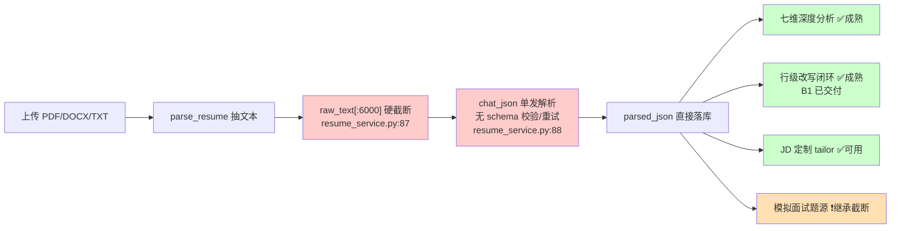
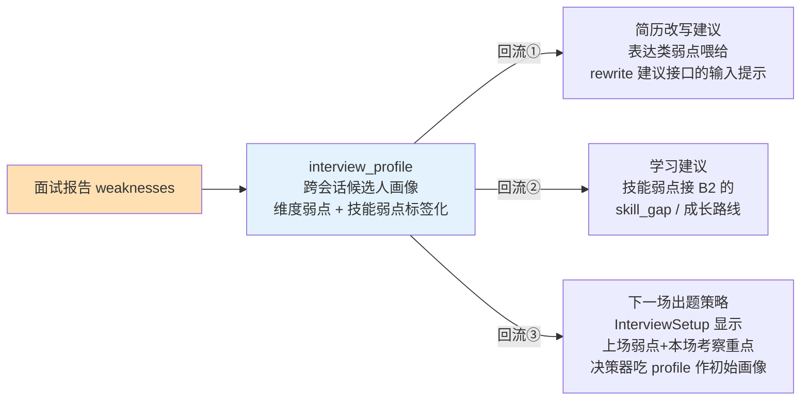

# 简历与面试模块优化计划

> 版本：v1.0
> 日期：2026-10-16
> 面向：产品负责人 + 后端/AI 工程
> 前提决策：六项已拍板（见 §2 决策记录，来自 grill 会话）
> 证据来源：对 `backend/app`（resume_service / resume_analysis_service / resume_rewrite_service / interview_engine / interview_ws / interview_rest / interview_evaluation_service / prompts/*）与 `frontend/src/features/{resume,interview}` 的代码审计，关键结论逐条带代码锚点
> 配套：`docs/upgrade-plan.md`（历史升级账，A–E 阶段已交付；本文件是**新一轮专项账**，不续写历史账）、`docs/engineering-quality.md`、`docs/面试消息协议.md`

---

## 1. 结论摘要

**一句话优先级：P1 地基必修 → P2 解析评测 → P3 动态面试官（主轴）→ P4 弱点回流闭环 → P5 体验收尾。**

| 期 | 内容 | 工作量 | 为什么排在这个位置 |
|---|---|---|---|
| **P1** | 地基与必修：简历/JD 解析截断修复 + schema 校验重试 + 面试超时按题型可配 | 3–4 天 | 解析是全漏斗地基（截断的简历让所有下游分析半份简历）；超时 30s 是用户可感知的硬伤。**测试护栏先行** |
| **P2** | 解析质量评测：`parse_eval` 评测集 + 脚本 + CI 门，接入前端评测报表 | 2–3 天 | 简历解析是**唯一没有评测覆盖的核心 AI 环节**；接上后"别家说 AI 准，本项目量出 AI 有多准"的故事闭环 |
| **P3** | **动态面试官（主轴）**：LangGraph 出题决策器（深挖/推进/生成三选一）+ 候选池机制 + 针对性追问 | 1.5–2 周 | 把多智能体从"编排分工"升级为"实时反馈决策"，补上 LangGraph 深度应用的答辩位；基建全现成（langgraph 依赖、memory_snapshot、异步评分、skill_gap） |
| **P4** | 弱点回流闭环 + 协同项：面试弱点 → 简历改写/学习建议/下场策略；题库种子扩充；两套出题入口打通 | 3–4 天 | 动态面试官产生的弱点数据质量更高，回流才有真材实料——所以接在 P3 后 |
| **P5** | 体验短板收尾：候选清单里挑 1–2 个（推荐断线重连 UI + 报告页闭环入口） | 2 天 | 与重点模块直接相关的体验面收尾 |

**总周期约 4–5 周。每期独立可交付、可中止。**

---

## 2. 决策记录（grill 会话产出，2026-10-16）

| # | 决策 | 选择 | 拒绝的选项及理由 |
|---|---|---|---|
| D-优化目标 | 首要目标 | **作品集亮点优先，真实可用作约束** | 纯可用性改进讲不出差异化；工程底座（902 测试、双轨评测、治理）已是答辩硬通货，缺的是 AI 能力深度的故事位 |
| D-简历边界 | 简历模块投入 | **地基加固 + 解析质量评测** | 拒绝多 Agent 解析流水线（信息抽取任务不需要，拆开只会慢和贵，答辩讲不出必要性）；拒绝 OCR/多模态（重依赖、新战线） |
| D-面试主轴 | 面试模块主轴 | **动态面试官**，弱点回流作二期 | 拒绝真实感优先（语音是重工程、故事弱）；拒绝闭环先行（静态面试产生的弱点数据质量撑不起回流） |
| D-LangGraph | LangGraph 角色 | **只重写出题决策器，外围引擎一行不动** | 拒绝全面重写（D 编号换来的防御逻辑——连接线程隔离、JSON 列竞态、租约认领——是最贵资产，重写等于重踩一遍已修的 bug）；拒绝原生实现（少答辩故事，且 langgraph 已在 requirements.txt:24） |
| D-其他模块 | "适当优化"边界 | **协同项 + 1–2 个体验短板** | 岗位市场/推荐/职业规划零投入（B2/B3 刚交付，边际收益低） |
| D-评测成本 | 样本量与预算 | **20–50 条小样本，真 provider 单轮个位数元，零新依赖** | 沿用 agent_eval（25 对）惯例；ASR/TTS/OCR 均不引入 |

---

## 3. 现状诊断（带代码锚点）

### 3.1 简历分析模块：地基是单发无防护的



| # | 发现 | 锚点 | 影响面 |
|---|---|---|---|
| R1 | **解析静默截断**：`raw_text[:6000]`，超长简历尾部直接丢弃，无任何警告或标记 | `resume_service.py:87` | 所有下游——七维分析、改写、匹配、面试出题——都在分析半份简历，且用户不知情。与 WorkBuddy 项目 CHUNK_SIZE 超 embedding 窗口是同族 bug（静默数据丢失） |
| R2 | **无 schema 校验、无重试**：`chat_json` 返回什么存什么，关键字段（skills/work_experience）缺失照样落库，下游拿到空结构只能各写各的兜底 | `resume_service.py:88-99` | `quick_score` / `analyze_resume` / `build_resume_blocks` 全部要防 None，浪费且脆弱 |
| R3 | 解析质量**不可度量**：`rag_eval`（检索）/ `agent_eval`（匹配）/ `eval_recommend`（推荐）三轨都有，唯独解析这一环没有评测。**立案当天复核改口**：缺的不是数据而是**跑者**——`backend/tests/eval/resume_parse_eval.jsonl` 已经在树里（字段级 gold：`input.raw_text` + `expected{name,phone,email,skills,years_exp,current_title}` + `required_fields`，形状正好），但**全仓没有任何脚本/测试/文档读它**；且 3 行里第 3 行是坏 JSON（`json.loads` 在第 380 列报 `Expecting ',' delimiter`，`input` 对象少一个闭合）。同批的 `interview_eval.jsonl` 4 行坏了 3 行，同样无人读。两支都随 `f1d512d release: v1.0` 入库 | "简历解析准确率"无数字可答，答辩被问到只能定性；而 P2 要建的事实上是 **runner + 把残缺语料扩到位**，不是从零造数据集 |
| R4 | JD 解析同族：同为单发 `chat_json` 无校验（它是面试出题的输入，质量上限被传导）。**锚点实测修正**：截断不在 `jd_parse_agent.py`（它只是 `jd_service.parse_and_save` 的壳，全文无切片），真正的位置是 `jd_service.py:27`，且阈值是 **4000** 不是 6000 | `jd_service.py:27`（原文误记 `agents/jd_parse_agent.py`） | 面试题针对性 |
| R5 | **同族截断还有两处，计划文档原稿没点**：`external_service.py:62`（`_RESUME_TEXT_MAX = 6000`，外部文本入口的第二条简历解析路）、`jd_embedding_service.py:71,81`（`RAWS_TEXT_LIMIT = 6000`，embedding 文本） | 前置度量顺带扫 `[:四位数]` 扫出来的 | 只修 R1 会留下这三处同族债；四处阈值不同（6000/6000/4000/6000），改阈值必须一起改 |

**已成熟、本轮不动的**：七维 rubric 评分（总分代码算、模型自报只作对照 `resume_analysis_service.py:114-134`）、行级改写（锚定块 + 校验门 + 撤销快照 + 重算匹配分）、quick_score 诚实标注局限、报告作业化 + 自包含 HTML、单项目/组合分析。

### 3.2 模拟面试模块：流程引擎成熟，智能层是模板

| # | 发现 | 锚点 | 影响面 |
|---|---|---|---|
| I1 | **超时 30 秒硬编码**：技术/场景题真实思考 1–3 分钟，30s 必超时；`MAX_QUESTIONS=10` 同为类常量，config 里无对应配置位 | `interview_engine.py:39-41` | 用户可感知的硬伤：系统设计题没法答 |
| I2 | **题目一次性静态生成**：starter 模板兜底 + 后台个性化替换（`_personalize_unstarted_questions`），面试过程中**无实时决策**——回答暴露的弱点不影响下一题 | `interview_rest.py:290-413`、`interview_engine.py:120-146` | "多智能体"在面试环节没有展示位：编排分工有，实时反馈决策无 |
| I3 | **追问是模板**：评分 <70 且 `follow_up=true` 时推**预生成或固定模板**追问（`"刚才的回答可以再深入一些吗……"`），不针对回答内容 | `interview_engine.py:253-277` | 深挖能力是假的，答辩被追问"追问怎么生成"会露馅 |
| I4 | **报告是终点**：weaknesses 落库后无任何消费方——不回流简历改写、不回流学习建议、不影响下一场出题 | `interview_engine.py:442-464` | "求职全流程闭环"创新点在面试这一环断了 |

**已成熟、本轮不动的**：WS 子协议认证 + 按连接持引擎 + 线程池隔离（D211/D212/D219 的账）、逐题异步评分 + 租约认领 + 重扫恢复（D163/D178）、断线恢复（`resume()` 全量从落库推断）、评分权重平台可配置（T3-2）、僵尸会话收口端点（D225 的配套）。

### 3.3 基建盘点（P3 动态面试官的现成弹药）

| 基建 | 现状 | 在 P3 中的角色 |
|---|---|---|
| `langgraph>=1.2,<2.0` | requirements.txt:24，orchestration 已有 `langgraph_*` 策略变体在用 | 出题决策器的状态机框架，同版本零新依赖 |
| `memory_snapshot` | `build_memory_snapshot`（interview_evaluation_service.py:430）已随评分更新 | 候选人画像的数据底座 |
| `skill_gap` | `jd_required_names` + 技能缺口识别已交付（B2） | 弱点识别的权威来源 |
| Retrieval Planner 模式 | "LLM 决策 + 启发式回退"双路已验证（C 阶段交付） | 出题决策器直接复刻这个模式 |
| 异步评分线程池 | 逐题评分本就后台化（`defer_evaluation=True`） | 决策调用同样走后台，用户端只见过渡态 |
| 平台配置表 | `interview_config`（题库/评分规则两级回落，T3-2） | 超时按题型可配走同一张表 |

---

## 4. 分期路线

### P1 地基与必修（3–4 天）

**目标**：解析从"单发无防护"升级为"有校验、可重试、不静默丢数据"；面试超时不再一刀切。

#### P1.1 简历/JD 解析健壮化（R1+R2）

**前置度量（只读，先量半径再动手——项目惯例）——已于 2026-10-16 量完**：
脚本 `backend/scripts/parse_truncation_radius.py`（只读，一条不写；`--json` 出机读数）。长度一律量**字符数** `char_length`，不是字节数 `length`——本库里同一份 1,664 字符的简历存成 4,142 字节，拿字节量会把半径**虚报 2.5 倍**（纯中文才是 3 字节/字符，简历里混着 ASCII）。

| 量的东西 | 实测（本地开发库 `llmXM`，MySQL） |
|---|---|
| 简历行数 / 去重后文本份数 | 26 行 / **10 份**（同一份反复上传撑大了分母，所以下面按"份"算）；另 1 行 `raw_text` 为 null |
| 长度分布（字符） | min 437 / p50 629 / p90 1,664 / **max 4,758** / 均值 1,257 |
| **R1 半径：>6000** | **0 份（0.0%）**，被切掉 0 字符；连"落在阈值 80–100% 带"（4,800–6,000）也是 0 份——最长的一份离阈值还差 1,242 字符 |
| **>15000（提议新阈值）** | **0 份**；最长一份只用掉新阈值的 **1/3.15** |
| JD：>4000（R4 真阈值）/>6000 | 73 行 / 51 份，max 282 字符 ⇒ 两个阈值都 **0 份**超 |

**这一半的读法（要如实说）**：R1/R4 在**本库当前零受害者**——它是**潜在缺陷**（上传一份 >6,000 字符的简历就触发；本库最长 4,758，只差 1,242 字符），不是在烧的火。修仍要修（尾部正是最近的工作经历，切掉的恰好最值钱），但**优先级排序不该靠"截断正在伤害用户"这个说法**，§6 风险 6 对 15000 的担心在本库也量不出来（本库全是短样本，测不出阈值够不够；真要定阈值得靠 P2 评测集的长简历）。

**顺带量到的 R2 半径——这个不是零，比截断更实在**（读已落库的 `parsed_json`，不调 provider）：

| 发现 | 数字 |
|---|---|
| 简历侧**库里已存着两代 schema 的产物** | 25 份有解析结果的：13 份是当前 prompt 形状；**12 份（48%）** 缺 `current_company`、缺 `self_evaluation`、多一个顶层 `school` |
| JD 侧更重：三代形状 + 大量没解析 | 29 份有解析结果的：16 份当前形状，**13 份（45%）** 属另外两代（8 份 `{education, experience, industry, skill_tags}`；5 份带 `jd_summary` 的导入/爬虫桩）；另有 **44/73 行 `parsed_json` 干脆是 null**（建了 JD 没走解析） |
| R4 传导路径实测到了 | JD `required_skills`：29 份里 **10 份是 null、5 份空数组**，只有 14 份真有值 ⇒ 出题拿到的必备技能 **52% 是空的** |
| 导出侧一条无数据支撑的分支 | 简历 `education` 25 份**全是 str**，而 `resume_export_service.py:432-438` 写了 list[dict] 分支（`e.get("school")`）——本库没有一行能走进那个分支 |

**度量改掉的修法（两条，不是原稿的形状）**：
1. **schema 必须分"键必须存在"和"值允许为 null"两档**。`app/prompts/jd_parse.py` 原文就指令"缺失字段填 null 或空数组"——把字段判成必填非空会**和 prompt 对着干**，校验一次通过率会被 prompt 自己的指令判红。简历侧同理（`years_exp` 已有 8/25 是 null）。
2. 原稿 §4 P1.1 的字段清单写 `projects`，**prompt 里的实际键是 `project_experience`**（`app/prompts/resume_parse.py:25`，下游 18 处引用）——照原稿写 Pydantic 会校一个不存在的字段。

**修法**：

| 项 | 现状 | 改成 |
|---|---|---|
| 截断 | `raw_text[:6000]` 硬切（**同族四处**：`resume_service.py:87`、`external_service.py:62`、`jd_service.py:27`(4000)、`jd_embedding_service.py:71,81`，见 R5） | 阈值提到 **15000**（qwen 上下文内）+ **结构感知截断**：超限时按简历段落优先级保留（基本信息→工作经历→项目→技能→教育→其他），从尾部丢低优先级整段，不硬切字符中间。三处 LLM 解析入口共用同一个常量与同一个截断函数；**第四处（embedding）刻意不并进来**，理由见下面"实现落地"第 3 条 |
| 截断标记 | 无 | `parsed_json["_meta"]["truncation"] = {"truncated": true, "dropped_chars": N, "dropped_sections": [...]}`，前端简历详情页显示"解析丢弃了 X 个低优先级段落" |
| schema | 无校验（实测：库里已有两代形状，简历侧 48%、JD 侧 45% 的已落行对不上当前 prompt） | 新增 Pydantic `ResumeParsedSchema`（name/phone/email/skills/work_experience/**project_experience**/education 的结构断言，键名照 `resume_parse.py:13-28` 抄，不是原稿的 `projects`）；JD 侧同套 `JDParsedSchema`。**两档制**：键必须存在 / 值允许 null（理由见上面度量段第 1 条） |
| 重试 | 无 | 校验失败 → **把校验错误回喂 LLM 修正一次**（self-correction，一次为限）→ 仍失败 → 落库 + `_meta["parse_degraded"] = true` + 前端黄条"解析不完整，建议检查原文格式" |

**测试护栏（先于功能代码，F1-0 纪律）**：
1. 长简历夹具（构造 >15000 字符、尾部含最新工作经历）：断言尾部经历仍被解析 + truncation 标记正确；
2. mock provider 返回残缺 JSON（缺 skills / work_experience 非法结构）：断言重试触发、二次仍失败落降级标记；
3. 结构感知截断单测：优先级表驱动的段落取舍断言；
4. JD 解析同套夹具对齐。

**护栏落地状态（2026-10-16，先于功能代码）**：文件 `backend/tests/test_parse_guardrails.py`，11 条 = 文档那 4 条 ＋ 3 条反向证据 ＋ 1 条"库里存全文"的回归钉 ＋ 2 条政策站岗。当前 **7 红 4 绿**，红的全部红在"契约还没实现"，不是夹具写歪：

| 红的那 7 条 | 红的真正原因（= 待实现） |
|---|---|
| 长简历保尾部（简历侧、JD 侧各 1 条） | 现仍是 `[:6000]` / `[:4000]` 从头上硬切——**这两条把 R1 变成了可复现的失败**：夹具一造出来就红，说明缺陷真实存在，哪怕本库受害者是 0 份 |
| 首发残缺触发自纠（简历侧、JD 侧各 1 条）＋ 二次仍失败落标记 | 无 schema 校验、无重试：`chat_json` 返回什么存什么 |
| 优先级表整段取舍 ＋ 极端预算保住"基本信息" | `app/utils/text_budget.py` 还没建（`PRIORITY_ORDER` / `fit_structured_text`） |

绿的 4 条有分工，不是凑数：`test_conforming_response_writes_no_meta_markers`、`test_short_resume_is_not_marked_truncated`、`test_jd_nullable_by_prompt_contract_is_not_a_validation_failure` 今天就能绿（现在根本没有校验），它们的活是**在功能落地之后必须仍然绿**——防的是"校验器把合规输出判成降级"这种修法；`test_raw_text_column_still_holds_the_whole_file` 钉的是"裁剪只发生在喂模型的那份，`raw_text` 列存全文"（今天成立，重构不许弄坏它——这条成立才意味着将来能重解析而不用让用户重新上传）。

**护栏里我自己加的、文档没有的三处，要否掉请直说**：
1. `_meta.validation_errors`（降级时把失败原因落库）。加的理由是 A2 那条产品决策——"对外静默 ⇒ 对内这条链必须真的可信"，只有一枚布尔标记的降级对内也查不出为什么降级。
2. `PRIORITY_ORDER` 的段名用真实简历写法（`项目经历`），文档表格里是简写（`项目`）。以测试为准，实现照测试抄。
3. 段名识别信号：夹具用"段名独占一行"。**这条原来是本修法最大的未验证假设，2026-10-16 已量**：13 份真实抽取文本、70 个段落、0 份完全认不出；漏认的 3 行全是 `▎` 这类装饰前缀，已收进前导字符类（读数与由此修出的两个真缺陷见下面"真实文本的识别率"一段）。**仍未验的那一半**：段名与正文挤在**同一行中间**（不在行首）的排布——识别器要求别名落在行首，那种形状会被当成正文而不是段名；本库这 13 份里没有这种样本，所以它今天是"没被证伪"，不是"已验"。

**一处与项目既有决策相撞，实现前必须拍**：修法表那两行候选人可见的提示（"解析丢弃了 X 个低优先级段落"、黄条"解析不完整"）与 2026-09-19 的成文决策冲突——那条决策点名"**截断提示**"属于对候选人静默的一族，且明确否决过"给候选人显示降级徽标"。护栏本身不依赖这两行（`_meta` 是数据，不是界面），所以实现可以照写，界面那一半先挂着。

> **2026-10-16 他已拍：这两行特批上屏。** 理由归到"讲的是用户自己上传的文件（超预算、原文格式），不是 AI 这次降级了"，与原决策不同族。**特批只到这一处**——mock 模板、备用模型、空答案兜底仍对候选人静默。例外与边界已写进那条决策本身，防止以后被"纠正"回去。

#### P1.1 实现落地（同日，后端那一半；前端两行未做）

新增 3 个模块，改动 3 处入口，**外围一行没动**（评分、改写、匹配、报告、WS 都不在这条链上）：

| 新文件 | 装什么 |
|---|---|
| `app/utils/text_budget.py` | `PRIORITY_ORDER` / `JD_PRIORITY_ORDER` 两张段表 + `build_section_map()`（别名按长度倒序进正则交替）+ `fit_structured_text()`：超预算时**整段**丢弃、同优先级丢更靠后的、结果恒为原文片段的拼接（不重排不改写） |
| `app/services/parse_guard.py` | `PARSE_INPUT_BUDGET = 15000`；`guarded_parse()`：预算内取文本 → 单发解析 → 结构校验 → **一次**回喂自纠（`REPAIR_HEADER` 那纸"判单"必须让模型认出这不是原文）→ 归一 `_meta`。`chat` 是**注入**进来的，不在本模块 import——否则测试换的是各服务自己那个名字，重试计数会静默停在 1 |
| `app/schemas/resume.py` / `jd.py` 各加一支 | `ResumeParsedSchema` / `JDParsedSchema`，**两档制**：字段不带默认值（键缺席即失败）＋ `\| None`（值取 null 通过）。内层经历/项目条目的字段一律可缺——一份写了 12 段经历、其中 1 段少 `start` 的简历不该整份判废 |

改动的入口：`resume_service.parse_and_save`、`external_service.parse_resume_text`、`jd_service.parse_and_save`（含它的壳 `JDParseAgent`）。三处都从"自己 slice"换成同一个 `guarded_parse`。

**四条实现期才知道的判定，原稿都没有**：

1. **始终留一段不丢**（`len(droppable) > 1`）。整份只有一栏超大工作经历时（很常见），按原稿"从尾部丢低优先级整段"会**丢到空串**——喂一发空 prompt 必然解析失败，比硬切更糟。留住的那段交给兜底硬切收进预算。这条是**覆盖率门照出来的**：那两条空分支被报告出来，追下去发现其中一条路会把唯一的内容丢光。
2. **embedding 那一处不并进 15000**（R5 的第四处）。`RAWS_TEXT_LIMIT` 量的是 embedding 模型的窗口，不是 LLM 上下文；套上 15000 会把它推过窗口边界——那正是本项目当反面教材的 CHUNK_SIZE 超窗同族 bug。已在源码注释里写明"要动它先量窗口"。
3. **JD 需要第二张段表**（`JD_PRIORITY_ORDER = 任职要求 → 岗位职责 → 基本信息 → 其他`）。文档的优先级表只针对简历，JD 用它会认不出任何段落而退回硬切。排序依据取自现成的下游依赖：`required_skills` 是 B2 skill_gap 的权威来源、也是模拟面试出题的输入。**这张表是我加的，文档没有**——要否掉请说，代价是那 3 条 JD 护栏退回"只打标记不保尾部"。
4. 顺手收掉一条旧崩溃：`chat_json` 返回 None 时，`resume_service.py:92` 与 `jd_service.py:36` 的 `parsed.get(...)` 都会 `AttributeError`（external_service 早就写了 `or {}`，另两处没有）。`guarded_parse` 统一归一成 dict，这条路径不再可能拿到 None。**没有为此单开测试**——它属于"被顺手修掉"而不是"被要求修"，如果要钉住该补哪一条，说一声。

**护栏状态：15 条全绿**（那 11 条 + 上面第 1 条带出的 3 条形状：无段名、段名前的引子、唯一超大段 + 真文本读数带出的第 15 条：段名前带装饰字符）。三条变异各有牙：

| 变异 | 打红几条 | 打的是哪几条 |
|---|---|---|
| `PARSE_INPUT_BUDGET` 退回 6000 | 1 | 长简历保尾部（工作经历整段被丢光） |
| 校验判据恒说合格 | 3 | 简历自纠、JD 自纠、两次仍失败落标记 |
| 截断退回从头硬切 | 2 | 长简历保尾部 + 优先级表整段取舍 |

**验收进度**：`ruff check` + `ruff format --check` 全过；backend 全量 **1346 passed / 0 failed**（当场记的是 1345/1，那条 failed 后来在 §8 判明是**我自己泄漏进命令的 `PYTHONIOENCODING=utf-8`**、与仓库无关；相对开工前的 1331 净增 15 = 这份护栏的全部），**零回退**。

#### 真实文本的识别率 + 那一发真 provider（同日补，这两条才是 P1.1 欠的账）

**一、别名表在真文本上认不认得出段落**（本地跑，零花费）。把库里 `raw_text` 不是 JSON 串的行全取出来（**13 份真文本**）过一遍识别器：

| 读数 | 值 |
|---|---|
| 识别到的段落总数 | **70 段**，每份平均 5.4 段 |
| 完全认不出任何段落的 | **0 份 / 13** |
| 段名频次 | 技能 29、项目经历 13、其他 13、教育 12、基本信息 2、工作经历 1 |
| 含别名却没被当段名的短行 | **3 行**，全部同一个字符打头：U+258E 左侧竖块 + `专业技能 / 项目经历 / 教育背景` |

**这一条把实现里两个真缺陷逼了出来**（都不是文档说的，也不是夹具能照出来的）：
1. 前导装饰字符类不收 `▎`（与它的全角竖线孪生），于是那份 4,758 字符的真 docx 里 `▎项目经历`、`▎教育背景` 整段没有归属——它的正文会被并进上一段、跟着上一段一起被丢。**已修**，并补了第 15 条护栏。修完识别总数从 50 → **70**。
2. 段的边界取了别名起点（`m.start(1)`）而不是整个匹配的行首，于是装饰字符被**留在上一段的尾巴上**：裁剪结果末尾会多出一个孤立符号，而那一明明是被"整段丢掉"的段。**已修**成 `m.start()`，护栏里数符号个数而不是看文本（比读文字更难糊过去）。
3. 顺带补了两个实测到的段名别名：`个人优势`（id 20）、`核心优势`（id 13）。真简历里它们不在这张表时，正文被并进"教育"一起按低优先级丢弃。

**二、那一发真 provider**。构造上说清楚，因为它决定这条读数能推到哪：库里**去重后的真实抽取文本一共只有 4 份、合计 9,570 字符**——拼到最满也过不了新阈值 15000，所以"新阈值下会不会切、切得对不对"**在这台机器上取不到真样本**，别把下面这条当成它的答案。这一发答的是另外两问：

| 判据 | 真读数 |
|---|---|
| 同一份真实文本在**旧阈值 6000** 下的伤害 | 会被丢掉 **3,602 字符**，尾部那 40 字符直接没了（本地算） |
| 这一发实际进模型的 | prompt **10,582 字符**，其中真实文本 9,597；旧阈值会切掉的那 **3,597 字符这一段这次真的到了模型**（trace 里 `prompt_text` 含落库文本的最后一行，逐字对过） |
| schema 一次通过率（真 provider） | **1/1**：`prompt_trace` 这一发期间**只新增 1 行** ⇒ 首发返回就过两档校验，自纠没被触发；返回体 12 个键、缺失键集合为空。`status=success / degraded=0 / response_source=real / 26,894ms`，墙钟 27.17s |
| 全文有没有保住 | 保住了：拿盘上那份 docx 重新抽文本，与落库 `raw_text` **逐字相等（9,597 == 9,597）**；`_meta` 为空（9,597 < 15,000 本就不该有标记）。我脚本第一版在这里报过"否"，那是拿**拼接前**的字符串比的，比错了对象 |
| 花费口径 | 只报**调用次数与字符量**，不报钱：`cost_cents` 单价仍全 0（既有账里记着），拿它当钱是假数 |

**这一发的边界**：n=1，只算第一颗热读数，不是"通过率"；而且四份不同人的简历拼成一份，解析内容本身是混叠的（返回 skills 56 项、work_experience 0 条、project_experience 5 条），所以它**只判形状，不判质量**。留下的痕迹：`tb_resume` id=**82**（用户 `testu`），上传文件在 `backend/uploads/2026/10/` 下（该目录 gitignore，工作树没被弄脏）——要清就在界面上删，我没动它。

**顺手撞到的一条环境事实**：上传被付费墙拒过一次——`免费版最多管理 1 份简历`（user 5 名下已有 6 份，`code=-7`）。活页要造真上传，得挑一个名下没有简历的账号。一次性脚本与仓库外的 docx 副本都已删。

#### P1.1 前端两行（同日，他特批之后落地；**真浏览器未验**）

落点选在**简历中心的每张卡片**（`ResumeUpload.vue`），不是评估报告页——`_meta` 是逐份简历的事实，卡片是它唯一说得通的位置；报告页那一棵树拿的是 report 不是 parsed_json。

| 判据 | 上屏形态 |
|---|---|
| `_meta.truncation.dropped_sections` 非空 | 卡片 meta 行末补一句"解析丢弃了 N 个低优先级段落（技能、教育）"，复用既有 `.card-meta`，**零新 CSS、零新色值** |
| `_meta.parse_degraded` | 卡片顶部一条 `el-alert type="warning"`："解析不完整，建议检查原文格式"（本页已有三处 el-alert，无注册成本） |

取数只有两个纯函数（`parseDropped` / `parseDegraded`），**前端不重推**任何判据——截断与降级的标记只由 `parse_guard.py` 盖一处，免得变成第三份真相。写的时候避开了 `statusTagEntries` 那把尺：它数的是脚本里 `键: 'warning'` 那种形态，**连三元式 `'a' : 'b'` 都算一条**，所以两条提示不能各绑一个 type，只能用一条静态 `type="warning"`。

夹具 `tests/unit/resumeParseMetaNotice.test.js` 6 条：丢段落那句、只有 truncated=false 不画、降级那条黄条、只有截断没有降级时黄句不出现、**两条都干净时一句都不出现**、以及"库里老行压根没有 `_meta` 这个键"（25 份已落解析结果全是这种，取数路径不成立就是整片白屏）。

**门数**：vitest 105 文件 / **718 条全绿**（含新增 6 条）、静态守卫 `npm test` **50 条全绿**、`typecheck` 0 条、`eslint .` 只剩一条不是我那份的旧警告、`prettier --check` 我碰的两个文件干净。行尾核对过：新文件纯 LF，改过的 `.vue` 没被改成混合行尾。

**变异有牙**：把取数键名从 `_meta.truncation.dropped_sections` 改成 `_meta.dropped_section`（接线断掉的最小形态），6 条里**红 2 条**——正是那两条要求句子必须出现的；三条"不该出现"的仍然绿，符合预期。

**真浏览器读数（2026-10-16 补，注入夹具法）**：起 8010 + 5173（Vite 的 dev 代理默认指向 8000，必须用 `VITE_PROXY_TARGET=http://127.0.0.1:8010` 指过去），凭据用现成的 `create_access_token({'sub':'5'})` 铸一枚——不新建账号、不改任何行的属主。往同一属主的三行 `parsed_json` 临时写 `_meta`（14 两标都有 / 15 只截断 / 16 只降级），另三行 17–19 原样不动作对照。

| 量什么 | 读数 |
|---|---|
| 四态是否真上屏 | 14：`解析丢弃了 3 个低优先级段落（技能、教育、其他）` **和**黄条 `解析不完整，建议检查原文格式` 都在；15：只有丢段落那句；16：只有黄条；17/18/19：两句都不出现 ← 反向证据是活页拿的，不是 jsdom |
| 黄条是不是"黄"的 | `el-alert--warning`，字色 `rgb(217,144,19)` 于底 `rgb(32,34,46)` ⇒ **5.98:1**（AA 4.5 过） |
| 新写的色值有几处 | **0 处**。丢段落那句与同排兄弟 span 的计算色逐字节相同（`#989baa` 于 `#171922` ⇒ **6.34:1**），它只是既有 `--app-muted` 的又一个消费者 |
| 窄屏会不会挤横滑 | 离屏定宽探针 280/320/360/400 四档：`metaScrollW == metaClientW`（242/282/322/362），`hostScrollW == 宽度`，**四档全部无横向溢出**；那句自己折到第二行（280px 时第三行）——`.card-meta` 的 `flex-wrap: wrap` 本来就在 |

**两条读法上的限制，别把上面的数当成万能读数**：
1. 这台内嵌浏览器是隐藏标签页，`window.innerWidth/innerHeight` 报 **0** ⇒ 所有 `(max-width: …)` 媒体查询全部命中，量的是**最窄那一档**。对"会不会挤横滑"这一问正好是要紧的档，但**不等于**用户真机 400px 下的完整排版。
2. 浅色没改页面去量（不赌注入—撤除）。按 `:root` 令牌算：`--app-muted #697386` 于纯白 **4.78**、于 `--app-bg #f4f6fa` **4.41**。那个 4.41 不是这轮引入的——同一行每个兄弟 span 都在用这支 token，我这句只是第 N 个消费者；它属于 §10.37 那一族（D161 他点"不动"），要重开按那条记录的重开条件走。

**收尾核对**：三行 `parsed_json` 按改前备份逐字还原，`select count(*), md5(group_concat(...))` 表级校验从 `880b2794…` 回到改前那个 **`9903403f5925804a3bb0946d87746357`**（26 行不变，三行 `_meta` 全部不在）；页面里 `token`/`user` 两个键清除、注入的探针节点归零；两个服务按各自 PID 定点停（不 `/IM` 网杀）、5173/8010 端口释放；仓库外的临时备份目录已删。**这条链现在没有任何一处"只有 mock 绿"**——除下面这一处。

**仍未做**：真 provider 20 份样本的 schema 一次通过率；以及**真实 PDF/DOCX 抽出的文本认不认得出段落**——两张段别名表目前只有夹具与注入数据撑著，那才是 P1.1 最大的一条未验证假设，只能由真上传那一发回答。

#### P1.2 面试超时按题型可配（I1）

| 项 | 现状 | 改成 |
|---|---|---|
| `TIMEOUT_SECONDS = 30` | 类常量硬编码（interview_engine.py:40） | 按 category 平台配置：`basic 45s / tech 120s / scenario 90s / project 120s`，走 `interview_config` 表（复刻 T3-2 scoring_rules 的"平台配置 → 内置默认"两级回落） |
| 前端计时器 | 按 30s 固定倒计时 | WS 推题时 metadata 带本题型 `timeout_seconds`，前端按值倒计时 |

**测试护栏**：各题型超时值从配置读取的断言（含未配置时回落内置默认的对照）；WS 消息 metadata 字段契约测试（`docs/面试消息协议.md` 同步更新）。

#### P1.2 落地（2026-10-16 同日，D238）

**动手前验到的四条前提偏差**——前两条会直接把修法改掉，所以先列在这儿：

| # | 验到的 | 对修法的影响 |
|---|---|---|
| 1 | 文档那行写"按 **category** 平台配置 basic/tech/scenario/project"，但 `category` 这一个字段**装着两种域**：starter 那条路塞的是 `_map_category()` 的**中文标签**（技术基础…），而既有夹具与模型生成的题把**英文题型键**写在同一个字段里。`interview_engine.py:130` 的 `category = question.get("category") or question.get("type") or "general"` 就是这层混用的现场 | 查表键必须是解析出来的 `type`，不能是 `category`。照字面实现会有**整族题静默查不中、永远拿默认值**，而屏幕上没有任何一处会说要这件事。新增 `resolve_question_type()`（`type` → `category` 本身是键 → 中文标签回推 → general），并加一条护栏钉"回推表必须是渲染表的逆" |
| 2 | 词表不止两套，是**三套且只交集于 `tech`**：配置层 `DEFAULT_QUESTION_BANKS` 与 `interview_question_bank.type` 的注释是 `{tech, hr, comprehensive, stress, group}`；运行时题目带的是 `{basic, tech, project, scenario}` | 新列按**运行时**词表填才查得中。今天这表 **0 行**所以无冲突，但真要在管理端配超时，得先对齐词表——这件事写进迁移文件、模型注释与 `TYPE_VOCABULARY_MISMATCH`，不当透明 |
| 3 | `TIMEOUT_SECONDS = 30` 的消费者**只有一处**（`interview_ws.py:195` 那句 `asyncio.sleep`），但前端 `stores/interview.js:15` 的 `ROUND_SECONDS = 30` 有**五处**：三处重置、**一个进度条分母**、以及两处 `<= 10` 的红色门槛与输入框提示 | 预算必须随消息下发且前端不再自己抄一个数。进度条分母不换过去的话，120 秒的一题会在 4 秒时显示成"时间到" |
| 4 | 前端 `formattedRoundRemaining` 写的是 `` `00:${String(secs).padStart(2,'0')}` ``——**这副模样是按 30 秒造的**，超时一旦到 120 就渲染成 `00:120` | 换成真的分秒（`02:00` / `01:30`）。文档 §4 那一行"前端按值倒计时"没提这件事，它是量出来的 |

**落地形状**：`interview_question_bank` 加一列 `timeout_seconds`（NULL=按内置默认）；`interview_config_service` 里 `QUESTION_TIMEOUT_SECONDS`（basic 45 / tech 120 / scenario 90 / project 120）+ `TIMEOUT_FLOOR_SECONDS = 45` + `timeout_for_type()`，回落与 `get_scoring_rules` 同形（平台行 → 内置默认 → 认不出题型 45）；`QUESTION_TYPE_LABELS` 收成一个出处，`interview_rest._map_category` 改成消费它；两处问题发射点（`next_question` 与追问）都盖 `metadata.timeout_seconds`；`interview_ws.timeout_for_payload()` 取那一题的数，脏值/缺字段一律兜 45，**类常量 `TIMEOUT_SECONDS` 从树上摘掉**（护栏直接断言这个属性不存在）。

**认不出题型时发 45，不是老的 30**：30 就是这条硬伤的根因，不该继续作为兜底值存在。这条写进协议文档，前端兜底也是 45。

**护栏 28 条**（后端 22 + 前端 6），变异各有牙：把 `timeout_for_type` 的平台行那一腿短路 → 后端红 **1** 条（正是"平台配置覆盖内置默认"那条）；把前端 `roundBudget.value = roundBudgetOf(meta)` 退回常量 → 前端红 **4** 条（兜底档与静态腿不受这条变异影响，它们各守另一件事）。

**写护栏时自己踩的两条仪器坑**（都不是代码坏，但都会伪装成代码坏）：
1. 那条静态守卫最初按**全文**扫 `InterviewEngine.TIMEOUT_SECONDS`，于是我写在注释里那句"原来睡的是类常量"把它自己打红了。改成只看**可执行行**——注释要留下来说明为什么摘掉，不该因此被自己的尺子绊倒。
2. 推 WS 消息后**没等刷帧**就读 DOM，三条断言读到的都是初始的 `00:45`；其中两条的期望值恰好也是 45，**会空过**（错了却绿）。把推消息做成 async 并一律 await 之后，6 条才是真的在判同一件事。

**没做的、要拍的**：
- **迁移写了未执行**（`migrations/versions/20261016_0033_question_bank_timeout.py`，alembic 单头是它）。执行前后端起在真库上会撞上 Unknown column——这一步要你亲口一句，我不自己 `upgrade head`。测试不受影响（sqlite 由模型建表，列已经在）。
- `MAX_QUESTIONS = 10` 同为类常量，文档 I1 提过但 §4 P1.2 只要求超时——**这条没动**。
- **重连/hydrate 不重新起倒计时**：`resetRoundTimer()` 只有 WS 收到 `question` 那一条路会调（store:223 附近），所以断线重进房间时倒计时不是这一题的预算。这是既有缺口，本轮**只记不改**，改它属于 P5(a) 断线重连那一格。
- **真浏览器没量**：倒计时要跑满 45–120 秒才有意义，本轮 6 条全是 jsdom 挂载 + 读数。要收这条得连真 WS 跑一场，与 P3 的会话节奏量可以并一次。

**门数**：backend **1368 passed / 0 failed**（1331 开工前 + 15 条 P1.1 护栏 + 22 条 P1.2 护栏；当场记的 1367/1 里那条 failed 见 §8——是我自己的 env，不是仓库缺陷）、`ruff check app migrations tests scripts` 全过、`format --check` 442 文件、`test_schema_baseline.py` 3 绿（快照已重生成，差异正好 1 行 = 那一列）；frontend vitest **106 文件 / 724 条全绿**、静态守卫 50 条、typecheck 0 条、eslint 与 prettier 干净。

**验收指标**：截断发生率（>15000 的简历占比）——**前置度量已给：本库 0 份（10 份去重文本，max 4,758 字符）**，修完之后这个数字应当**仍是 0**；它证明不了新阈值够用（本库全短样本），真正的验证挪到 P2 那 2 份 >15000 长简历。schema 校验一次通过率（真 provider 20 份样本——判据用上面第 1 条的两档制，否则 prompt 自己指令的 null 会把通过率打下来）；`test_parse_guardrails.py` 那 7 条红全部转绿、且 4 条反向证据**必须仍然绿**；全部现有测试不回退（**基线已按 2026-10-16 现取数修正，见 §8 那条**）。

---

### P2 解析质量评测（2–3 天）

**目标**：简历解析纳入既有评测框架。用词订正一处：R3 自己列的就是**三轨**（rag / agent / recommend），所以 parse 是**第四轨**不是第三轨——下面所有"第三轨"的字样按第四轨读。"解析准确率"从定性变定量。

#### P2 前置盘点（2026-10-16，只读。三条把原稿的形状改掉）

**一、语料供给算不够，原稿那 20–50 份凑不出来**。把 `backend/uploads/` 全量过一遍抽取：

| 量的东西 | 实测 |
|---|---|
| 简历文件 | **26 个**（19 pdf + 7 docx，`txt` 与图片 **0 个**） |
| 按字节去重 | **6 份**（重复最多的一组出现 **18 次**——同一个文件被反复上传） |
| 抽出文本后再去重 | **5 份**；其中**唯一一份超 6,000 字符的是我自己上一轮真上传造的测试件**（`tb_resume` id=82，9,597 字符） |
| 树里原有的真实素材 | **4 份不同文本，最长 4,758 字符**；抽取失败 1 个（`b2fe2b49….pdf` 抛 ValueError） |

⇒ 原稿要求的"20–50 份 + 三格式 + 中英文 + 应届/社招/转行 + 2 份 >15000 长简历"**不可能从本机现有素材里组出来**，尤其 txt/图片两档是 0 个、>15000 一档也是 0 个。语料必须**新造**，而"谁来写 gold、真实性怎么证"是 P2 的第一个判断（见 §9 待拍板）。

**二、报表页只有两轨，第三轨是漏的**。`/api/eval-reports` 那侧支持 `{rag, agent, recommend}`，而前端 `EvalReport.vue` 的两个下拉**写死 RAG / Agent**，"recommend" 在整个文件里出现 **0 次**——可 AI 发布门 `AI_RELEASE_REQUIRED_EVALUATION_TYPES` 偏偏**要求 recommend 那一型**。所以"parse 与 RAG/Agent 并列可见"这句要改成：**顺手补上已经缺一轨的那张页面**，否则新轨会变成页面上的第三个硬编码遗漏。报表**没有数据库表**（`backend/reports/*.json`，目录已 gitignore），脚本走 `--output` 落盘、读端按文件名前缀与 `report_type` 判型。

**三、三轨惯例是现成的，照抄不发明**：`argparse` + JSONL 标注（跳过空行与 `#`）+ `check_thresholds()` 判红（退出码 3，被闸拦是 2）+ `--output` 写 JSON + 入口 `require_mock(...)`；`provider_guard.py:7` 明写着"真 provider 下全量 50 条 RAG 评估未批，别擅自跑"。mock 只门窗法/结构那一面的成文原话在 **`README.md:260`** 与 **`docs/engineering-quality.md:161`**。数据集侧还有两条可以借的锁：`agent_eval` 用"≥25 条 / ≥20 个不同分值 / 四个分段各 ≥3 条"钉**语料本身**的形状（`test_eval_thresholds.py:345-354`），`recommend_eval` 用一条测试**逐条重算标签**、并写明"不要改成用被测代码回生成标签"（`test_recommend_eval.py:150-173`）——parse 轨的 gold 客观字段（电话/邮箱/技能词）正该用后一种形状钉住。

**顺带一条未验的**：`scripts/eval-quality.ps1`（真 provider 质量门）**没设 env、也没传 `--allow-real`**，按 `provider_guard` 的语义它在 `.env` 是 qwen 的机器上应当 **exit 2 被拦**。这条是读代码推出来的，**没有实跑**（实跑会花真钱），要收它得等他点名。

- **评测集**：`tests/eval/parse_eval.jsonl`，20–50 份带标注简历（字段级标准答案）+ 10 份 JD。覆盖：pdf/docx/txt 三格式、中英文、应届/社招/转行、含 >15000 长简历 2 份（同时量 P1 截断修复的真实效果）。
- **脚本**：`scripts/eval_parse.py`，指标：
  - 字段级抽取准确率（name/phone/email/skills/experience 的 precision / recall）
  - 结构完整率（schema 校验一次通过比例——P1 的 schema 直接复用为判卷器）
  - 截断发生率 + 截断丢弃段落分布
- **CI 纪律**：沿用 eval_rag 的 mock 教训——mock provider 只门"链路可跑通 + 词法可判项"，**不门语义准确率**（mock 向量按 hash 生成的教训在 README 技术亮点一节已有成文）；真 provider 评测手动触发，预算个位数元。
- **前端接入**：结果进 `eval-reports` 体系，评测报表页与 RAG/Agent 报告并列可见。**已按实改口**：报表页原来**只列 RAG 与 Agent**，后端与发布门都要的 recommend 在页面上是 0 次出现；这一格把它收成一张 `REPORT_TYPES` 表（卡片、两个下拉、指标列、对比块全从它派生），四轨一起出现。

#### P2 落地（2026-10-16，D238）

| 新/改的东西 | 是什么 |
|---|---|
| `backend/scripts/gen_parse_eval.py` | 语料生成器。**方向是"先有画像（gold）再排版出文本"**——`recommend_eval` 头注释那条"标签不许由被测代码回生成"在这里的对偶。带 `--check`（语料与生成器必须逐字一致，CI 用）与一批形状锁 |
| `backend/tests/eval/parse_eval.jsonl` | 42 条：合成简历 28（含 2 份 >15000）+ JD 10 + **真文本臂 4**（已脱敏）。真文本那 4 行排在**文件头**，所以 `--sample 4` 就是"只跑验真臂" |
| `backend/tests/eval/real_resumes/*.txt` | 那 4 份真文本落成明文夹具，离线可复现，不连库。**入库前过了 `redact()`**：原文里带一位真人的姓名、手机号、QQ 邮箱与就读学校，2026-10-17 拍板"脱敏后再入库"——按"已进 git 历史的不动"那条，手机号一旦提交就再也拿不回来，而这不是他自己的数据。版式、长度档、段分布一字没动（评测真正测的是这些） |
| `gen_parse_eval.py::redact()` | 脱敏那一层。**按 token 定槽，不按文件序号**：4 份排版其实只有 2 个人（3 份同一人 + 1 份演示数据），按文件序号发假名会把一个人变成三个人，而生成器末行那句"覆盖了几个人"数的是 gold 里的不同姓名 ⇒ 它会跟着说谎。假号走 `138001380XX` 保留号段、假邮箱走 RFC 2606 的 `example.com`。幂等：已脱敏的文本再跑一遍一字不改，留着是防"下次有人把原始导出直接扔进夹具目录" |
| `backend/scripts/eval_parse.py` | 两臂跑者：确定性臂（不碰 provider）+ 语义臂（真跑才出数），`report_type:"parse"` 落 JSON |
| `backend/tests/test_eval_datasets.py` | 19 条：每行必须可解析、同一文件顶层键形状必须一致、语料必须与生成器逐字一致、承诺过的覆盖度（≥24 简历/≥10 JD/≥4 真臂/2 份长简历/中英/三档 cohort），**外加 4 条 PII 门**：夹具与语料只许出现假身份表里的值、身份分组必须保持 phone→name 的函数性、还有一条反向样张（明显像真人的必须被判红） |
| `app/api/evaluation.py` | 加 parse 型（判型、归一、对比三处），对比时**一边没跑语义臂 ⇒ 差值是 None 不是 0** |
| `frontend/.../EvalReport.vue` + `tests/unit/evalReportTracks.test.js` | 类型收成一张表 + 5 条页面断言（含"语义臂未跑不许显示成 0"） |
| `.github/workflows/ci.yml` | 新一步：`eval_parse.py --min-tail-keep 1.0 --max-errors 0`（只门确定性臂） |
| `scripts/eval-quality.ps1`（顺带，与 P2 无依赖关系） | 修那条坏了 11 天的质量跑者：加 `[switch]$AllowReal`，不带就把 `LLM_PROVIDER`/`EMBEDDING_PROVIDER` 钉成 mock（CI 口径，零花费），带才追加 `--allow-real`。详见 §9.6 |
| `backend/tests/test_ps1_encoding.py` | 3 条：`scripts/*.ps1` 必须纯 ASCII（PowerShell 5.1 按 ANSI 读无 BOM 文件，中文行尾会把下一行并进注释、静默不执行）+ 一条判这把尺本身不是摆设 |

**读数（mock，零花费）**：42 条全跑通；截断发生率 **0.0476**（2/42，正是那两份长简历）；**段尾保全 25/25 = 1.0**；丢段分布 `{'其他': 4}` —— 与 P1.1 的优先级表一致，低优先级整段先丢、工作经历留在预算内。语义臂在 mock 下**主动跳过并明说原因**（mock 的 `chat_json` 对任何输入回同一份 `_MOCK_RESUME`，"准确率"是常数对常数）。

**门数（2026-10-17 干净环境现取，含真臂脱敏那一轮）**：backend 全量 **1391 passed / 0 failed**（1331 开工前 + 15 条 P1.1 护栏 + 22 条 P1.2 护栏 + 16 条 P2 语料与报表门 + 3 条 `.ps1` 编码门 + 4 条 PII 门；连跑逐字一致）、`ruff check app migrations tests scripts` 全过、`ruff format --check` 449 文件；frontend vitest **107 文件 / 729 条全绿**、静态守卫 50 条 / 0 失败。脱敏之后确定性臂的读数**一字未变**：截断率 0.0476、段尾保全 25/25 = 1.0、丢段 `{'其他': 4}`（这正是"只换身份 token、不动版式与长度"应该有的样子）。CI 新加的那一步按 CI 的口径复跑过（job 级 `LLM_PROVIDER=mock`+`EMBEDDING_PROVIDER=mock`，见 `ci.yml:23-24`），读数逐字复现、exit 0。**注意一条会被踩的**：本地把那行命令原样抄下来跑（不带那对 env）会被自家 `provider_guard` 拦成 **exit 2**，因为 `backend/.env` 里 provider 是真的——门没坏，是拦对了；这与 §9.6 那件"`eval-quality.ps1` 疑似被自家闸拦"是同一族，见该格。

**三条得写在明面上的限制**：

1. **字段级基线：n=4 的真臂第一发已经跑了（2026-10-18，他点名）**。读数（`reports/parse_real_arm_20261018.json`，provider 真、`response_source=real`、4 条全 `status=success`、`degraded=0`、`errors=[]`）：**`first_pass_rate = 1.0`**（四发都是首发就过两档结构校验，一次自纠都没触发）；三个标量字段 **name / phone / email 召回都是 1.0**——但同一张表里 **`regex_baseline_recall` 也是 1.0**，也就是**与不用模型的正则直取打平，一分没赢**。更关键的一件事：**`lists = {}`，一个列表字段都没被评分**——不是模型没抽出来，而是**真臂没有 list 的 gold**（那几行的标签是正则从原文取的，只能取电话/邮箱/姓名；技能、经历、项目这些要人来标，而"标签不许由被测代码回生成"那条纪律禁止我自己造）。所以：**P2 验收指标那一格现在能给的只有"结构一次过 + 三个标量与正则打平"**，真正能体现解析价值的段落抽取，得先给 4 份真文本补人工 gold。门槛仍未设（`min_field_f1 = None`）——按文档那条"门槛由第一次跑出来的数定"，第一发的数已经在这儿了，设多少等他点。花费实测（`prompt_trace` id 1652–1655）：**15,363 tokens**（prompt 7,291 / completion 8,072）、prompt 13,528 字符、模型时间合计 109.7 秒；`cost_cents` 恒 0 是因为价目表没这两个模型，**不等于没花钱**。跑法：`python scripts/eval_parse.py --sample 4 --allow-real --output reports/xxx.json`（真臂那 4 行在文件头）。
2. **原稿那句"覆盖 pdf/docx/txt 三格式"没兑现**。两臂都是从 `raw_text` 进去的，**没过文件抽取层**——他拍的是"双臂：链路进 CI、质量手动"，射程里没有实物文件那一档。所以 `uploads/` 里那个抽取直接抛 ValueError 的 pdf（`b2fe2b49….pdf`）今天仍在评测半径外。要收它得再造一批实物文件（pdf 还没有可用的写出库）。
3. **真文本臂只有 2 个人、4 种排版**（库里真实素材的全部）；合成分是"我知道答案才写的题"，F1 天然偏乐观。所以：**合成分只当回归基线，能当产品能力说的只有真文本那一臂**——这条已经写进生成器的注释，不靠人记。**2026-10-17 起那一臂是脱敏过的**：姓名/手机号/邮箱/学校换成固定假值，版式与长度一字没动，所以它测的还是"真实排布的解析"，但引用时要说"真版式 + 假身份"，不能说是"真人的简历解析结果"。分组关系有门盯着（同一个人不能因为脱敏变成三个人）。

**建这一格时门抓到的我自己的四次错**（都是"看着对、实际坏"）：
- **脱敏第一版把一个人变成了三个人**：我按文件序号发假身份（第 1 份 → 假名 A、第 2 份 → 假名 B…），可那 3 份排版是**同一个真人**。后果不是难看，是**数字说谎**——生成器末行"覆盖了几个人"数的是 gold 里的不同姓名，于是 2 个人报成 4 个。发现它的是我自己加的那条 phone→name 函数性门；改成按 token 定槽后 `DISTINCT_IDENTITIES = 2`。顺带两条：把真值写进注释等于换个地方再泄露一次（第一版注释里就复述了姓名与手机号，已删）；按长度回库里找原文时 `func.distinct(col)` 混在 select 列表里不是去重，SQL 直接报错、我以为跑成功了。
- **第三版才算修对**：`eval-quality.ps1` 我第一版把解释写成了中文注释和中文 `Write-Host`，看着装好了——**其实那两行 `$env:... = "mock"` 根本没执行**。尺是 PowerShell 自己的：文件 79 行、`Get-Content` 报 73 行（少的正好是 6 行中文注释），Parser 却报 0 错误；逮住它的是临时树里那支替身 `python` 打出 `provider=/`。改成纯 ASCII 之后 85 = 85、子进程真读到 `mock/mock`。教训落成一条门（`test_ps1_encoding.py`）：**在这个仓库往 `.ps1` 里写中文，会让紧随其后的代码静默不执行，且不报任何错**。
- `test_no_mojibake.py` 红了两次（同一族）：第一次我给人名用了"沈砚青"这种写法；第二次是脱敏表里的假名"赵晓波/赵晓雨"。那道门按**字频**判"像不像 GBK 误读"，而且判的是**整串稀不稀有**，不是单字——同一批里"郑晓东"是干净的，"赵晓X"连续两次被判。换常用串即可（现在那四个假名旁写了注释：改名字先跑那条测试）。这台机器的写入通道本来就会改写生僻码位，那条门就是为这类事立的。
- `styleDebtRatchet` 红了一次：我把标签颜色判断挪进 script，写成 `key === 'rag' ? 'success' : 'primary'`——**这正是我上一格刚记进文档的那个坑**（那把尺数的是脚本段里 `键: 'color'` 这种形态，连三元式都算）。改回留在模板里，并写了为什么。
- 另有一条**测量有效性**的自纠：段尾保全第一版报 25/28 = 0.8929，查下去红的那 3 条是 `fresh` 档——模板里压根没有工作经历段，needle 从来没在原文出现过。跑者改成只数"needle 确实在原文里"的样本，生成器同时加一条不变式（声明了 needle 就必须能在原文里找到），下次这种形状在**造语料那一步**就红。

**验收指标**：字段级 F1 基线数字落库（首次跑出来的数字就是基线，不设拍脑袋门槛）；报告可在前端评测报表页查看。

---

### P3 动态面试官（主轴，1.5–2 周）

**目标**：面试官 Agent 每轮根据回答质量实时决策下一题（深挖/推进/生成），把"多智能体"从编排分工升级为实时反馈决策；LangGraph 状态机作决策核心，外围引擎不动。

#### P3.1 架构

```mermaid
flowchart TB
    subgraph 外围["InterviewEngine（不动）<br/>WS/评分/租约/断线恢复"]
        A[收到回答] --> B[异步评分<br/>现有线程池]
        B --> C[评分落库 + memory_snapshot 更新]
        C --> D["问决策器要下一题<br/>（唯一改动点：next_question 的题源）"]
    end

    subgraph 决策器["InterviewerDecisionGraph（新增，LangGraph StateGraph）"]
        D --> E[update_profile<br/>更新候选人画像<br/>强弱项/已覆盖考点/追问深度]
        E --> F[decide<br/>三选一：deepen / advance / generate]
        F -->|deepen| G[针对模糊点生成追问<br/>LLM 现场生成]
        F -->|advance| H[候选池按画像重排选题<br/>零 LLM 延迟]
        F -->|generate| I[RAG 检索 + 生成新题<br/>暴露新弱点时]
        G --> J[产出下一题 + 面试官过渡语]
        H --> J
        I --> J
    end

    J --> K[推送题目<br/>前端显示"面试官思考中"过渡态]

    subgraph 兜底链["决策失败逐级回落"]
        L[LLM 决策异常] --> M[启发式规则<br/>评分&lt;70且未追问→deepen<br/>否则候选池顺序推进]
        M --> N[starter 模板<br/>现有机制]
    end

    style 外围 fill:#e8f5e9
    style 决策器 fill:#e3f2fd
    style 兜底链 fill:#fff3e0
```

**关键设计**：

| 设计点 | 决策 | 理由 |
|---|---|---|
| LangGraph 边界 | 只写决策器 `InterviewerDecisionGraph`（update_profile → decide → compose_question 三节点状态机）；`InterviewEngine.next_question` 的题源换成"问决策器"，其余一行不动 | D-已拍板。防御性基建是最贵资产；决策器是纯新增代码，状态转移图直接可画 |
| 延迟策略 | **混合动态**：开场个性化候选池扩到 12–15 题（现有 `_personalize_unstarted_questions` 扩展）；advance 从池选题零延迟；deepen/generate 现场生成 + "面试官思考中"过渡态 | 每题都现场生成会让节奏不可忍受；混合法把 LLM 等待限制在"值得等的时刻" |
| 决策双路 | LLM 决策 + 启发式回退，**复刻 Retrieval Planner 的已验证模式**（`RAG_USE_PLANNER` 一族） | mock 模式可跑（答辩演示不依赖真 provider）；LLM 不可用不卡会话 |
| 追问升级 | I3 的模板追问 → 基于回答内容的针对性追问：输入 = 评分 evidence + 回答中的模糊点（未量化的成果、含糊的技术选型），输出 = 单点深挖问题 | "刚才的回答可以再深入一些吗"这种模板在答辩时是负资产 |
| 面试官过渡语 | 决策器每次附带一句话（"我注意到你提到了 X，我们深入聊聊"） | 真实感增强，零额外调用，与答题超时无耦合 |
| 成本 | 单场调用次数 10 → 12–18（每轮 +1 决策，deepen/generate 再 +1 生成） | 真 provider 单场成本可控；mock 模式零成本 |

**测试护栏（先于功能代码）**：
1. 决策器单测：三档模拟评分输入（好/中/差）→ 启发式路径决策输出的确定性断言；
2. 状态机完整性：LangGraph 状态转移覆盖测试（三节点全路径可达、无死状态）；
3. 兜底链变异：LLM 决策抛异常 → 落启发式不卡会话；启发式题源空 → 落 starter；
4. 现有面试测试全绿（`test_interview_engine.py` / `test_interview_async_evaluation.py` / `test_interview_question_generation.py` 等不回退）；
5. WS 消息协议向后兼容：新增 metadata 字段可选，老字段不动（`docs/面试消息协议.md` 同步）。

**P3.1 决策器落地状态（2026-10-17，护栏先红后绿）**：`backend/tests/test_interview_decision_graph_guardrails.py` 红着落地那一笔是 `ae502d0`（**13 红 1 绿**，全量收集 1405 条不炸；模块 import 包在 try 里，所以红是断言级的红、不是收集期 ImportError）；实现落地后这份护栏 **14 条全绿**。实现是 `backend/app/services/interviewer_decision.py`：`DEEPEN_SCORE_CEILING = 70`、`decide_heuristic`（零 LLM 零 DB）、`InterviewerDecisionGraph`（三节点声明 + `compile()` 出真 LangGraph 图）、`decide_next(state, chat=注入)`——**先启发、判出 advance 就立刻返回，一次网络往返都不发**（混合动态那格"≥75% 题目零额外等待"的全部价值在这里），判出 deepen 才让 LLM 组织追问，它炸了就落回启发式自己拼的那句并带 `degraded`；题源空 ⇒ `starter` 兜底且永远给得出题面。模块里没有一行取库代码（那条断言钉着）。定点复核跑的是**所有面试与决策相关测试：146 passed**——原稿第 4 条"现有面试测试不回退"就是这么证的，没为此跑全量。**收口时跑了一次全量：1405 passed / 0 failed**（1391 + 这份护栏 14）。测试节奏按他 2026-10-17 定的那条走：一格内只跑改动模块的定点测试，全量每格只在收口时跑一次。

**两处得写在明面上的自纠**：

- **边界那一侧我一开始判错了**：原稿写"评分 **<70** 且未追问→deepen"，我那条护栏却断言 70 这一档也 deepen。实现照原稿、判据改回原稿 ⇒ **70 归推进**。边界归哪边必须钉死：测试与实现各写一边，谁都不会红。
- **变异验证逮出我自己写的一条空断言**：`decide_next` 返回的 `question` 是**一整个题目 dict**（引擎按 dict 用），所以 `assert decided.get("question")` 永远为真——我把 starter 那档的题面改成空串，**14 条照样全绿**，那条护栏在空转。改成 `_question_text()` 判到题面字符串之后，同一个变异让 **2 条转红**，恢复实现再跑 14 条全绿。与本仓库那条老教训同族：**判据的粒度别大过缺陷的粒度**。

**协议先行、发射在后**：`docs/面试消息协议.md` 加了可选键 `decision`（`{action, source, degraded?}`），并明写**今天的真实消息里还没有这个键**——`next_question` 仍按会话创建时冻结的那份列表取题，接线（含"生成的题要能回填这条会话"）在下一格。"既有六个 metadata 键不许动"那条断言现在就绿着，新键只许可选。

**这一格没做的**：引擎接线（P3.1 第二格，即下面那句"不是改一行"的落点）、P3.2 三档考生脚本与动态 vs 静态对比、前端"面试官思考中"过渡态、真 provider 的决策延迟数字。原稿五条之外我加的那两条（下一题不许变空、决策器不许自己开会话）**已实现并被断言钉住，仍等他点头承认这是原稿之外的加法**。

**引擎接线那一格的护栏已红着落地（2026-10-17，`tests/test_interview_dynamic_question_guardrails.py`，3 红 3 绿）**。接之前量到一条会咬人的东西，它决定了这条链的形状：

> **超时那一题不许触发深挖。** `_rebuild_evaluations()` 给超时写的是 `overall_score = 0` 且带 `timed_out: True`（`app/services/interview_engine.py:664-681`）。决策器的启发式只看分数，`0 < 70` ⇒ 判 deepen ⇒ 候选人**一个字都没说**的那题，面试官会追一句"你刚才提到的成果是怎么量化的"。那不是深挖，是幻觉。所以"没有回答文本"这一档必须在进决策器之前就被挡掉。

三条红的是新行为本身：低分且真答过 ⇒ 出一条追问且**不动 `current_index`**；追问不占 `round`、不改 `total`（前端进度条的分母就是 `total`，指针一多一少就画歪）；`INTERVIEW_USE_DECIDER` 关掉时必须与今天的顺序**逐字相同**——这第三条同时是原稿第 4 条"现有面试测试不回退"的可执行版本：真出意外就关一个开关回到今天这条链，而不是回滚代码。三条绿的分别是"超时不触发追问""既有六个 metadata 键不许少""同一题最多追问一次"，它们现在就该绿。

**接线落地（2026-10-18，那份护栏 3 红 → 6 条全绿）**：开关 `settings.INTERVIEW_USE_DECIDER`（默认开）+ 引擎里两个新函数（`_decision_state`、`_maybe_followup`）。追问只在"答过、有文本、分低于 70、且这题还没被追问过"四件事同时成立时发出；发出时 `current_index` 不动、`round` 报被追问那一轮的号、`total` 不变、`turn_id` 是 `q-N-followup`。定点跑面试与决策那一族 **152 passed**，收口全量一次 **1411 passed / 0 failed**。

**这一格又抓到两条自己的错，都不是实现错、是判据与形状错**：

- **把 metadata 拆成变量，静态守卫立刻看不见那枚章**。P1.2 落的那条花括号配对守卫是按 `"type": "question"` 之后紧跟的 `"metadata": {` 取字典体的；拆出去之后它取到的是别处的花括号，于是判"第三处发射点没盖章"。**这条守卫是对的**——它防的就是"新增发射点漏盖章"，所以我改的是发射形状（内联回去），不是放宽守卫。副作用记一句：那条断言写的是 `len(dicts) >= 2`，现在实际有三处，判据名该叫"至少两处"，暂时不动它。
- **`current_index` 的语义第一版测错**：它是"**已发出的最后一题**下标"（`next_question` 先自增再取），我按"还没出题"写夹具，两条判据期望的序列都错。改判据、不动实现，并把这句语义写进测试注释。

**这一格明确没做的**（是留给下一格的口子，不是漏）：① 决策器只走**启发式**那一档（`chat=None`），LLM 现场组织追问还没接——延迟与花费都在那一档，接的时候要有超时与降级读数；② **重连与逐题评分对"同一轮出现第二条 question 消息"的行为未验证**：追问的 `turn_id` 是 `q-N-followup`，而既有评分链按 turn 关联，这条我没量过就不说它没事；③ P3.2 三档考生与动态 vs 静态对比、真 provider 的决策延迟数字（前端过渡态已在下一格收掉）；④ 验真臂的段落 gold 由他本人标，模板已放 `backend/tests/eval/human_gold_TO_FILL.json`（**语义臂今天还不读它**，接进判卷是下一格 ⇒ 填完不会立刻改变任何数字，这是设计不是坏）。

**重连与评分链验证（2026-10-19，他点的下一格）——这一格挖出一条设计碰撞**：`handle_answer` 里**本来就有一套 I3 模板追问**（按评估自带的 `follow_up` 且分低触发，`turn_id` 是 `q-N-follow-up`），而这一格接的决策器追问是第二套。两套并存时同一轮会被追两次（先模板一条、`next_question` 再决策一条）——实测到的消息轨迹是 `question → answer → evaluation → question`，两条追问同一轮。原稿 P3 写的就是"**I3 的模板追问 → 基于回答内容的针对性追问**"，是升级替换而非并存，所以修法是：**开关打开时由决策器独占追问，模板那套只在开关关掉时启用**（代码没删，让位）。行为变更照实改了两处测试：`test_low_score_triggers_follow_up` 的判据改成新形状（带 `decision` 而不是 `evaluation.score`），并新增 `test_template_followup_when_decider_off` 证明"关掉开关，模板追问回来"。

验证到的三条链语义（都有断言）：

1. **追问发出、还没答时断线** ⇒ 重连把**同一条**追问再推一次（不丢）；
2. **追问已答** ⇒ 重连不重推，且下一题是**下一道主题**（`round 2`），不会在同一个短板上再追一遍；
3. **评分行独立**：追问的答案落成自己一行（`turn_id = q-N-followup`、`is_follow_up = 1`），不与主题的 `turn_id` 相撞——撞了就会覆盖主题的评分。

这里还有一条**我第一版测试的错**：我用一份静态的评估列表去测重连，结果"答完追问"之后状态仍然显示"没追过"，引擎就合规地又追了一次。真实实现是从消息/评分表重建的，所以夹具改成**按已保存的答案消息重建**（`_stub_from_messages`）才测的是真状态。定点跑面试与决策那一族 **156 passed**；收口全量一次 **1415 passed / 0 failed**。

**LLM 现场组织追问已接（2026-10-19）**：`decide_next` 现在真的会拿到一个 `chat`——引擎的 `_decision_chat()`，外面套着 `_bounded_chat()`，截止时间是新设置 `INTERVIEW_DECISION_TIMEOUT_SECONDS = 6.0` 秒。四条护栏（那份文件现在 13 条）：

- **LLM 给了合法动作** ⇒ 用它给的题面，`decision.source = llm`；
- **LLM 炸了/超时/回了一个不是 deepen|advance 的动作** ⇒ 落回启发式模板句、`degraded = true`、题面不许空（**mock 的常量正属于第三类**，所以 mock 跑出来的追问是启发式那句 + `degraded=true`——别把 mock 的绿读成"LLM 那一档跑过了"）；
- **advance 那一档零 LLM 调用**：用一个记调用次数的假 chat 验的，高分推进时一次都没发；
- **硬截止**：把预算调到 0.1 秒、让假 chat 睡 0.5 秒，断言整发在 0.4 秒内带着启发式那句回来——候选人不能为一句追问等两分钟。

**三条得说白的边界**：① **6 秒是我选的预算，不是量出来的**——2026-10-19 真 provider 那一发撞了 429（12 次决策 7 次降级），6 秒截止在降级路径上生效，但干净的单发延迟仍未知，文档里"决策延迟 2–5 秒"仍是假设；② 超时那一刻底层请求还可能在跑，`_bounded_chat` 只是不再等它（线程池 `shutdown(wait=False)`），代价是极少数慢请求白花一次 token；③ 送给决策 LLM 的是**画像摘要**（最近得分、弱点、证据摘录、已覆盖分类、追问深度），不是整份回答原文。定点跑面试与决策那一族 **160 passed**；收口全量一次 **1419 passed / 0 failed**。

**前端过渡态（2026-10-19）——先验了前提，发现它不用新做**：`TranscriptPane` 底部本来就有一条 `status === 'evaluating'` 的提示（"面试官正在记录你的回答并决定下一问..."），提交答案即出现、收到下一题即消失，**P3 要的"思考中"其实一直在屏上**。所以没有加第二个气泡（那会是重复），只补了延迟判据：store 里 `interviewerThinking` 在提交后 **400ms** 才置真——正常的"评完就出下一题"不换文案（避免每次答题都闪一下），越过 400ms（现场组织追问最多 6 秒）才把底部那句换成"**面试官正在思考下一问...**"；收到 `question`、`end`、`error` 或断开时一律清掉，不让那句话挂在屏上。判据 7 条（store 4 + 面板 3），连"400ms 内就收到下一题 ⇒ 一次都不显示"都钉了。前端全量一次 **108 文件 / 736 条**、静态守卫 50/0、typecheck 与 prettier 干净。

**这格没做的**：真浏览器量"从提交到出追问的墙钟"（要起后端 + 真 provider 的追问那一发，没批）；P3.2 对比评测。

动笔前把原稿 P3.1 的三个前提都到库里核过了，都成立，锚点如下：LangGraph 是**已装已用**的（`requirements.txt:24` = `langgraph>=1.2,<2.0`，实装 1.2.10，`app/orchestration/langgraph_flow.py` 已在用 StateGraph/Send）；`_personalize_unstarted_questions` 在 `backend/app/api/interview_rest.py:504`；而**"题源换成问决策器"这一句比原稿写的更重**——题目列表是**建会话那一刻冻结**的（`interview_rest.py:94` 把 `ordered_questions` 整份写进 `InterviewSession.questions`），`InterviewEngine.next_question` 只是 `questions[self.current_index]`（`interview_engine.py:154`），所以引擎侧不是"改一行"，是把"按下标取"换成"问决策器要下一题 + 拿回的题目要能回填进这条会话"。这一处偏差要在实现那格写进文档，不能等做的时候才发现。

原稿五条之外我**加了两条护栏**（等他点头，跟 `JD_PRIORITY_ORDER` 那格同一个规矩）：③ 兜底链不许把"下一题"变成空（`decide_next` 任何输入组合都要回一个 question，否则候选人那边就是面试被决策器提前结束）；⑤ 决策器不许自己开 DB 会话（引擎只有 `self.db` 一个入口；决策器里出现 `SessionLocal`/`get_db(` 就是第二条独立会话链，而 D44 已经查过：**那种形状没有任何门会红**，所以只能靠断言钉）。

#### P3.2 动态 vs 静态对比评测

- **考生脚本**：好/中/差三档模拟考生（预写回答脚本，含"刻意暴露弱点"的差档）；
- **对比维度**：
  - **弱点命中率**：`skill_gap` 识别的弱点中被出题覆盖的比例（动态 vs 静态 starter）；
  - **区分度**：三档考生总分差（动态应不小于静态——能拉开分说明决策有效）；
  - 会话节奏：平均每题等待时长（混合动态的目标：75% 以上题目零额外等待）；
- **门槛**：弱点命中率 动态 ≥ 静态 + 20 个百分点；区分度不降。门槛赢不过就判红（沿用 agent_eval "赢不过基线就红"的纪律）。

**诚实标注**：真 provider 下的决策延迟数字、追问质量人工抽样评分，这两项在计划期是**未验证假设**，P3 执行时量到什么写什么。

**P3.2 前置：弱点池今天没有数据源（2026-10-19 核出并已补）**。三处事实串起来就是一个哑掉的信号：① 建会话时写的快照只有 `question_generation`（`interview_rest.py:98`）；② 每轮重建快照的 `build_memory_snapshot()` 返回 `covered_categories/strengths/risks/summary`，**没有 `weaknesses`**，而且是**整份覆盖**；③ 决策器读的正是 `memory_snapshot["weaknesses"]`（`interview_engine.py:223`）⇒ **永远读到空**，追问里那个"你在{弱点}上具体做过什么"的分支是**死代码**，而空掉的那一侧不报任何错。

口径按他点的：**用 JD 必考技能当弱点池**——它表达的是"岗位必考、还没考到"，不是"候选人不会的"，引用时要这么说。改动三处：建会话把 `jd_required_skills` 写进快照；`build_memory_snapshot()` 改为**保留已有键**（否则第一题答完，池子就被整份覆盖抹掉）；引擎 `_decision_state` 读这个键（旧 `weaknesses` 键仅留作兼容，今天没有写入端）。验证：3 条新护栏（快照跨轮存活、决策状态带上池子、证据为空时追问落在具体技能上）+ 面试与决策那一族 **163 passed**；因为动了**建会话与快照两条共享路径**，按"共享底座要跑全量"的例外跑了一次全量：**1422 passed / 0 failed**。

**顺带修掉自己一个健壮性 bug**：`_decision_state` 在空评估列表上会 `evaluations[-1]` → IndexError（单元测试直接调用时炸出来的，生产调用点永远至少一条），已加空列表守卫。****P3.2 本体（2026-10-19，脚本化对比跑者已落地、门已跑绿）**：`backend/scripts/eval_interview_dynamic.py` + 用例 `tests/eval/interview_dynamic_cases.json`（6 道 starter、4 个必考项、三档脚本化考生）。读数（mock，零花费）：

| 档 | 静态覆盖 | 动态覆盖 | 增益 | 零额外等待 | 决策调用 |
|---|---|---|---|---|---|
| good（88 分） | 0.00 | 0.00 | +0pp | **100%** | 0 |
| mid（62 分） | 0.00 | **1.00** | **+100pp** | 50% | 6 |
| weak（42 分） | 0.00 | **1.00** | **+100pp** | 50% | 6 |

门的两条语义定死：**增益门只对"分低于深挖阈值"的档生效**——强档每答都对、本来就不该触发追问，拿它的 0pp 撞门等于把设计目标当普适指标；**零等待门只对强档**（≥75%，实测 100%）。两处都绿，退出码 0。

**跑者一上手就挖出三个真缺陷，全是"不报错的哑掉"**：① **追问把证据字典原样念给候选人**（`你刚才提到「{'source': 'synchronous_evaluation'…`），修法是只取 `answer_excerpt` 那类人话项；② **评分行落后时同一题被无限追问**（轨迹里同一轮连发 8 条），根因是轮次取了 `len(evaluations)` 而不是引擎指针——修法两处：轮次取 `current_index + 1`（正常路径两者相等，行为不变），外加"消息记录里已追过就不再追"的兜底；③ **`start()` 把快照整份写成 `{}`**，开局就把必考技能池抹掉（覆盖率一直是 0 的根因）——这是"快照被整份覆盖"的**第三个**现场，前两个是 `build_memory_snapshot()` 与个性化那条路。三个都补了判据。

**诚实边界（必须一起读）**：覆盖率 1.00 是**构造性的**——追问是从必考项里挑的，覆盖必然走到满；它证明的是"链路把岗位必考项带进了追问"，**不证明追问质量**。区分度在脚本化评分下两臂同分（构造性），真区分度得等真 provider 那一发。另外这一轮我犯过一次操作错误：诊断脚本直接 import 跑者内部函数、**绕过了 `require_mock` 闸，误打了 6 次真 provider**（1,867 prompt + 2,016 completion tokens，其中 3 次落到备用模型）——教训：诊断也必须走脚本自己的闸。

**真 provider 一发（2026-10-19，他点名「跑 P3 真 provider 那一发」）**：命令是 `backend/.venv/Scripts/python.exe scripts/eval_interview_dynamic.py --allow-real --output reports/interview_dynamic_real.json`，`provider=real`、模型 `deepseek-v4-flash`，12 次决策调用（good 0 / mid 6 / weak 6）。**这一发撞上了 HTTP 429**：主模型与备用模型合计打出 **7 行 `LLM degraded response ... fallback_model`**，对应 7 次决策落到模板；只有 **5 次由模型现场组织**（mid 前 4 条 + weak 第 5 条）。读数：

| 档 | 静态覆盖 | 动态覆盖 | 增益 | 零额外等待 | 决策调用 | 决策墙钟（总/均） |
|---|---|---|---|---|---|---|
| good（88 分） | 0.00 | 0.00 | +0pp | **100%** | 0 | 0 |
| mid（62 分） | 0.00 | **0.75** | **+75pp** | 50% | 6 | 21.7s / 3.62s |
| weak（42 分） | 0.00 | **1.00** | **+100pp** | 50% | 6 | 32.3s / 5.39s |

门仍绿（有缺口的档增益 ≥20pp、good 零等待 ≥75%），但**这张表不能当成"真 provider 决策延迟"读**：

- 6 秒硬截止包住了整次 `chat_json`（含两次重试与备用模型尝试）；7 次降级里有几次就是贴着截止线返回的。**3.62s / 5.39s 是成功与降级混在一起的墙钟**，干净的单发模型延迟要等配额恢复后重跑。这一发真正能说的是：**429 没有把会话卡死**——12 次决策全部产出了一句追问，覆盖率门照样过，降级模板把必考项带进了题面。
- mid 的 0.75 不是链路退化：`向量检索` 被第 3 条真追问带进题面；第 5/6 条落到模板后依次挑了 `分布式事务`、`可观测性`，`容量规划` 还没轮到题面。**覆盖率是词法判据**（必考项名是否逐字出现在题面里），真模型爱换说法——它写的"如何判断检索结果的质量"没有逐字说"向量检索"，这类**语义命中但词法不命中**会被记成未覆盖。这是这条指标的已知偏差，不是这一发才有的。
- **追问文本样本（5 条真模型；输入是三档逐字重复的脚本答案）**：mid 的 4 条里前两条**逐字相同**（两轮回答/证据完全相同，模型给了同一句），去重后三句是「你提到主要是调参和接接口，能否具体说明你如何判断检索结果的质量，以及调参时依据哪些指标？」「你提到向量检索主要是调参和接接口，那如果让你从零实现一个向量索引，你会怎么设计？」「你提到主要做调参和接接口，能否具体讲一个你亲手排查过的检索链路超时问题？」；weak 的 1 条是「能否详细讲讲向量检索的实现细节？」。要评追问多样性，得先把脚本答案改成多份。
- **兜底模板样本**：`你刚才提到「做过一些检索相关的工作，主要是调参和接接口。」，回到分布式事务这块：具体是怎么做的、结果怎么量化？` 降级路径仍把必考项带进题面，所以 mid 的 0.75 里也有模板的贡献。
- **仍未答的**：区分度（三档分数是脚本写死的，两臂必然同分）；干净的真模型单发延迟与超时占比；真实追问质量的人工抽样评分（5 条、且输入重复，样本不够）。跑者已补上 `decision_composed / decision_degraded / decision_ms_max` 三个字段（mock 复跑：mid/weak 各 6 次全降级、`ms_max` 16ms），下一次真跑从报告里就能直接读这组分流，不用再从日志里数 429。

**重试一发（同日，他点名「重试 P3 真 provider 那一发」，最多一次）**：同一命令、报告落 `reports/interview_dynamic_real_retry.json`。结果**还是 429，而且更重**：12 次决策只有 **2 次真组织、10 次降级**（mid 2/4，weak 0/6）。读数：

| 档 | 静态覆盖 | 动态覆盖 | 增益 | 零额外等待 | 决策调用 | 真组织/降级 | 决策墙钟（总/均/最大） |
|---|---|---|---|---|---|---|---|
| good（88 分） | 0.00 | 0.00 | +0pp | **100%** | 0 | 0/0 | 0 |
| mid（62 分） | 0.00 | **1.00** | **+100pp** | 50% | 6 | 2/4 | 34.2s / 5.69s / 6.02s |
| weak（42 分） | 0.00 | **1.00** | **+100pp** | 50% | 6 | 0/6 | 36.0s / 6.01s / 6.02s |

- **这发把 6 秒硬截止量实了**：weak 六次全降级，总 36.0s、均值 6.01s、最大 6.02s——6 秒截止不是文档里的假设，是降级路径的实测上界（多出的 16ms 是线程/计时开销）。mid 的 5.69s 均值则是 2 条真调用 + 4 条降级混在一起。
- **干净模型延迟仍然没有**：10/12 降级意味着这发同样不能当"真 provider 决策延迟"读；两发加起来只有 7 条真追问样本（第一发 5 条、这发 2 条；这发 mid 的两条是 HNSW 索引结构、可观测性定位线上问题）。**按"最多一次"停手，不再连续烧**。
- **归期已拍（2026-10-19）：P3.2 按现有两发收口，干净真延迟与质量样本归 P5**——配额恢复后若要跑，再由他点名。区分度是脚本评分下的构造性同分，**不随重跑解决**，不在这条的归还范围。
- mid 从 0.75 回到 1.00 主要来自降级模板把 `分布式事务`/`容量规划` 点名带进题面；真组织的两条里 `向量检索`、`可观测性` 也逐字出现。**覆盖率仍是词法判据**，不要把它读成"追问质量提升"。
- 跑者的新字段在这发里第一次生效：`decision_composed=2 / decision_degraded=10 / decision_ms_max=6016`，且每条 transcript 带 `decision` 元数据；以后不用再从日志里数 429。

---

### P4 弱点回流闭环 + 协同项（3–4 天）

**目标**：面试报告从终点变枢纽——weaknesses 结构化后三路回流；动态面试官的弹药库（题库种子）补齐；两套出题入口统一数据层。



| 项 | 内容 | 锚点/复用 |
|---|---|---|
| interview_profile | `memory_snapshot` 扩展出跨会话层：弱点标签结构化（维度弱点：完整性/深度/表达；技能弱点：对齐 skill_gap 词汇表），需要一张新表或 user 级 JSON 列（migration 走 schema-baseline 同步纪律） | `build_memory_snapshot` 已有单会话版 |
| 回流① 简历改写 | 面试暴露的表达弱点（"成果未量化""结构混乱"）→ `build_rewrite_suggestions` 的 jd_text 位置增加 weakness 提示位 | `resume_rewrite_service.py:156-165` |
| 回流② 学习建议 | 技能弱点 → 职业规划页的技能缺口卡直接引用面试证据（"上次面试 3 次未答出 Kafka 消费语义"） | B2 的 skill_gap 已交付 |
| 回流③ 下场策略 | InterviewSetup 页显示"根据上次面试弱点，本场将重点考察 X"；P3 决策器把 profile 作为初始画像（开场候选池按弱点倾斜） | 与 P3 同一张画像 |
| 题库种子扩充 ✅ **2026-10-20 落地并入库** | `interview_q` / `skill_model` 各补 **26 条**（20–30 区间），按岗位族组织——动态面试官 generate 路径的弹药；离线形状门 `--check` 通过后已入库 **16 份 / 52 chunk**（DB 28→44、Chroma 413→465） | `docs/knowledge-seeds/*/role_families/` + `import_knowledge_seeds.py --check` |
| 出题入口打通 | 智能分析页 `InterviewQuestionAgent` 与模拟面试候选池共用题源 schema 与检索路径（现在两处各自拼 RAG 查询） | `interview_question_agent.py:41-54` vs `interview_rest.py:_build_personalized_prompt` |

**P4 第一格（2026-10-19，已落地）：跨会话画像的派生层 + `GET /interview/profile`**。原稿给的是"新表或 user 级 JSON 列"，这里**改成按需派生、不落库**：画像是已完成会话报告的纯函数，数据量只有几十场；而未执行的迁移会让 `tb_user` 的每条查询当场 Unknown column（P1.2 的教训）。等有性能证据再谈持久化，不拿一笔没跑的 DDL 换缓存。

- **结构**：`app/services/interview_profile_service.py` 把每场已完成面试压成 `session summary`，再按 `session_id` 幂等合并；窗口保留最近 **10 场**。维度弱点阈值 **65**（对齐现有 `/interview/performance` 的口径），技能弱点阈值 **70**（对齐 P3 决策器的深挖线）。
- **三类分开**：技能出现在低分题里 → `skill_weaknesses`；题面提到但**超时未答** → `unanswered_required`；本场**没考到** → `unasked_required`。超时不算"这项不会"（P3 同一条纪律），也不算"没考到"。
- **词表对齐**：技能匹配走 `skill_gap.skill_match_terms()`，`K8s` 能在题面的 `Kubernetes` 上命中；短 ASCII 名按词边界匹配（`Go` 不会在 `Google` 里误命中）。多场按样本数加权，同一场重放不双计。
- **路由**：`GET /api/interview/profile` 返回 `has_data / total_sessions / dimension_scores / dimension_weaknesses / skill_weaknesses / unasked_required / unanswered_required / weakness_texts / strengths / last_session`；内部 `sessions` 明细不外发。
- **判据**：新增 `tests/test_interview_profile.py` **12 条**（维度/技能弱点、超时语义、别名与词边界、幂等合并、样本加权、10 场窗口、只取已完成会话、空画像形状、路由挂载与直接调用、完成时间排序）；`test_skill_gap_authority` / `test_career_evidence` / `test_interview_performance_max` 同跑 **59 passed**；收口全量 **1437 passed / 0 failed**（新增 12 条中的 11 条在全量内；路由挂载那条随后单独 1 passed）。
- **P4 全部项已落地**（截至 2026-10-20）：画像派生、三条回流、题源统一、题库种子。P5 的报告页闭环入口与断线重连另由 P5(a)/(b) 收掉。

**回流①（2026-10-19，已落地）：改写 prompt 多吃一条"上一场面试弱点"**。`build_rewrite_suggestions` 在带 `user_id` 时读 `get_profile`，取 `weakness_texts`（最多 3 条）与 `expression/depth` 两维弱点，拼成一句 hint；没有历史或画像读取失败就回落"无；按通用简历质量改写"——后者是锦上添花的一路，不能把改写主路一起拖死。

- Prompt 新增 `【上一次模拟面试暴露的弱点（只用于决定改写侧重，不是新事实）】` 段，硬性规则补一句"只决定先改哪类句子、不得据此补写候选人没写过的内容"；`prompt_version` 从 `resume-rewrite-v1` 升到 **v2**。
- 画像文本按不可信数据边界包成 `<interview_profile data-role="untrusted">`：候选人可以在回答里写"忽略上述指令"，那句话会被总结进 `weaknesses`，所以它的信任等级与简历正文相同。
- 判据：新增 **4 条**（弱点进 prompt、只属于简历主人、无历史回落、画像查询失败不挡主路），改写那一族 **37 passed**；改写作业与 prompt 渲染两组 **16 passed**；收口全量 **1442 passed / 0 failed**。
- **边界**：只改了 rewrite prompt 的输入，不改建议校验、不落库、不动前端；**真 provider 下建议质量有没有变好还没量**（要花钱那一发）。另外现有验证器只挡锚点/原文/长度，**没有事实验证器**——"弱点提示诱导补写事实"这条风险见 §6 第 8 行。

**回流③（2026-10-19，已落地）：上一场的弱点进新会话，决策器排到必考项前面**。

- **建会话**：`create_session` 把 `compact_profile(get_profile(...))` 写进 `memory_snapshot["interview_profile"]`；画像查询失败只记一条日志并落空结构，不阻塞本场创建。快照只带技能弱点（名称/均分/场次）、表达/深度维度弱点、最多 4 条报告原话与上一场摘要，不搬证据卡与逐场明细。
- **决策器**：`_decision_state` 把本场 JD 必考项按"上一场技能弱点优先"排序；不在本场 JD 里的旧弱点只出现在 prompt 的 `prior_profile` 里，**不进焦点池**，避免面试官追着别岗位的旧短板问。`DECIDE_PROMPT_HEADER` 明写 `prior_profile` 是旧弱点、不是本场证据，不许说成本场表现或据此编话。
- **设置页**：右侧新增"下一场考察重点"面板，显示上一场技能弱点（最多 4 个，带均分）、最多 2 条报告原话与一句"只决定先后、不当本场表现"的说明；无历史显示下一步提示；画像加载失败走独立 `AppLoadError`（可重试），不伪装成空态。
- **判据**：后端新增 **5 条**（紧凑快照不搬证据、建会话快照带上画像、画像弱点排前、别岗位弱项不进焦点池、旧画像进决策 prompt 且带"不是本场证据"），面试/画像/决策那一族 **85 passed**；收口全量 **1447 passed / 0 failed**。前端新增 **1 文件 / 3 条**（面板显示、无历史空态、画像失败独立失败态），全量 **109 文件 / 739 条** + 静态 `.mjs` **50 条**；typecheck、prettier、eslint、样式债尺均干净。
- **边界**：前端只在 jsdom + 静态尺上验过，**没有起真后端做活页**（本地活页要 MySQL 与可登录夹具，这一格没做那一步）；设置页展示的是"上一场弱点 + 本场会优先深挖与岗位必考项重合的点"的说明，**不逐项计算交集**；真 provider 下画像是否真的改变出题顺序，也还要一场真面试才量得到。

**回流②（2026-10-19，已落地）：职业规划页的方向缺口与"优先补齐能力"都引用候选人自己的面试证据**。

- **后端**：新 `career_evidence.attach_interview_evidence()` 按 `canonical_skill` 把画像里的 `skill_weaknesses` 贴到 `/career-path/recommend` 的 `gap_skills` 上——**只标注已存在的缺口，不新增**；每处带 `avg_score / sessions / samples / evidence[0]`。响应新增 `interview_profile` 摘要（`has_data / last_session / weakness_count / matched_gap_count / skill_weaknesses`）；画像读取失败只记日志，不挡方向推荐。
- **前端**：方向卡的"主要缺口"逐条显示"上次面试 N 场考到，均分 X，最近一问：…"；方向卡底部一行"上次面试留下 N 个技能弱点，已在 M 个缺口上标出证据"；完整规划产出的"优先补齐能力"卡也用同一份 `skill_weaknesses` 按归一化拼写匹配，匹配不上就不贴。
- **判据**：后端新增 **4 条**（同名缺口才贴、K8s/Kubernetes 走共享别名表、不新增缺口、接口端到端），`test_career_evidence` **32 passed**（与 skill_gap 同跑 **49 passed**）；收口全量 **1451 passed / 0 failed**。前端新增 **1 文件 / 4 条**纯函数/形状判据 + **1 条**方向卡组件用例，全量 **110 文件 / 744 条**；typecheck、prettier、eslint、样式债尺均干净。
- **边界**：方向缺口用后端完整别名表匹配；完整规划的 `skill_gaps` 没有 canonical 字段，只能按归一化拼写匹配（K8s vs Kubernetes 这类会漏），前端不做第二套别名表；前端同前两格，**没有起真后端做活页**；真 provider 下 CareerAgent 会不会用这些证据写学习建议，还没量。

**P4 收尾（2026-10-19，已落地）：两处出题入口共用题源**。

- 新 `app/services/interview_question_source.py` 收掉五件事：`search_types_for`（题型→查哪些知识库）、`build_rag_query`（title + 前 5 个技能）、`fetch_interview_question_context`（同一 query / `top_k=3` / doc_type）、`format_rag_context`（同一 `===== dtype =====` + `【doc_title】text[:CONTEXT_SNIPPET_CHARS]`，默认 300）、`normalize_question`（题目 schema，category 走 `QUESTION_TYPE_LABELS` 唯一出处）。
- `InterviewQuestionAgent` 与 `_build_personalized_prompt` 都走这条检索；agent 返回值额外带平铺 `questions`（原四桶保留给旧读方），REST 的 `_normalize_generated_questions` 也走同一个 `normalize_question`；`create_session` 的私有 `type_hints` 删掉，改用 `search_types_for`。
- 判据：新增 `test_interview_question_source.py` **7 条**（题型映射、查询词、同一 query/top_k、schema、agent 接线与输出、REST prompt 接线、REST 归一化）；受影响四组 `test_interview_config / test_public_job_flows / test_interview_question_generation / test_agent_trace_attribution` 同跑 **27 passed**；收口全量 **1458 passed / 0 failed**。
- **边界**：只统一**题源检索与题目 schema**，两个 prompt 本身仍不同（分析报告的面试题 vs 会话题面）；题库种子当时还没扩充（2026-10-20 由下一格补上并入库：16 份 / 52 chunk），真 provider 下召回质量未复测。

**P4 最后一格（2026-10-20，已落地）：题库种子按岗位族补到两类各 26 条**。

- **内容**：`docs/knowledge-seeds/{interview_q,skill_model}/role_families/` 共 **16 个文件、52 条**（每类 26 条）。题库覆盖后端 8、前端 4、数据 4、AI/LLM 4、DevOps 2、产品 2、行为 2；能力模型覆盖后端/前端/数据/AI 应用/DevOps/SRE/产品/测试/安全/数据分析/数据科学/通用素养/职级梯度 **13 个岗位族**。每条四字段（题目/考察点/参考要点/追问；核心能力/典型证据/评估锚点/常见短板）。
- **形状**：每个文件直接以 `##` 条目开头、不放一级标题——`chunk_document` 按标题切片，否则会多出一个只含标题的 chunk 去占 `top_k=3` 的名额。单条上限 **250 字**，叠加导入侧 50 字 overlap 后仍 ≤300，正好落在 `format_rag_context` 的截断线内；实测最大条目 **243**、最大 chunk **282**。300 字截断提成 `CONTEXT_SNIPPET_CHARS` 常量，种子门与 prompt 共用同一个数。
- **门**：`import_knowledge_seeds.py --check` 离线校验（不碰 DB、不调 embedding）：字段齐全、标题与题目不重复、条目与 chunk 长度、每类 20–30 条、岗位族至少 6 个，并禁止一级标题（否则会切出只含标题的 chunk 占检索名额）。新增 `test_knowledge_seed_corpus.py` **7 条**（形状门、条目数、字段与唯一性、prompt 窗口、岗位族覆盖、三条坏样本的反向证据、`--check` 入口）；与题源 7 条、导入 1 条同跑 **15 passed**；收口全量 **1465 passed / 0 failed**（144.19s）。
- **顺手修掉的**：`import_knowledge_seeds.py` 原来没有把 `backend/` 加进 `sys.path`，README 里那条“从仓库根跑”的命令其实起不来；已补上，`--check` 从仓库根验过。
- **入库（2026-10-20，他点名执行）**：`python backend/scripts/import_knowledge_seeds.py` 实跑，**16 份全部 ready、52 个 chunk、0 失败**（两类 7 / 9 份，chunk 数 26 / 26）；DB 文档 **28→44**，Chroma **413→465**。`embedding_usage` 当日行记 **16 次调用 / 52 条文本 / 0 缓存命中 / 16 个网络批次**（qwen `text-embedding-v3`）。导入按 title + 文件名 + doc_type 幂等跳过，重跑只补新增文件。
- **边界**：形状、长度与落盘已证；**仍未证明** embedding 召回质量，也没在真 provider 下复测两处题源，这两项留后续抽样。

**测试护栏**：回流管道测试（报告 weaknesses → 三路消费者各拿到的结构断言）；两处题源 schema 一致性守卫；profile 累积逻辑（多场面试弱点合并去重）单测。

---

### P5 体验短板收尾（2 天，执行时挑 1–2 个）

| 候选 | 说明 | 推荐 |
|---|---|---|
| a. 断线重连 UI | 后端 `resume()` 断线恢复已很强（防重推已答题都处理了），前端 InterviewRoom 对重连状态的感知提示不足 | ✅ **已落地（P5(a) 2026-10-19）** |
| b. 报告页闭环入口 | 面试报告页加"去改简历 / 去补技能"入口（P4 回流的前端面） | ✅ **已落地（P5(b) 2026-10-19）** |
| c. §10.37 浅色作用域 | upgrade-plan 在册 open 项，前端样式债 | 不抢（与两模块无关，单独拍） |
| d. 简历解析进度感知 | report-jobs 异步化已有，上传→解析→诊断的进度展示优化 | 备选 |

**P5(b) 报告页闭环入口（2026-10-19，已落地）**：`InterviewReport.vue` 底部新增"去改简历 / 去补技能"。

- **去改简历**：把这场面试的 `resume_id` 写进简历中心的默认简历槽（`selection.rememberDefaultResume`）再跳 `/resume-center`；简历中心 `onMounted` 读 `defaultResumeId`，所以打开的是这份简历而不是列表第一份。
- **去补技能**：把 `resume_id / jd_id` 写进跨页选择槽（`rememberResume` / `rememberJD`）再跳 `/career-planning`；职业规划页 `restoreSelections` 接住，方向链自然加载。
- **判据**：新增 `interviewReportClosure.test.js` **2 条**（两个按钮都在、路由落点、选择槽的值）；前端全量 **111 文件 / 746 条** + 静态 `.mjs` **50 条**；typecheck、prettier、eslint、样式债尺均干净。后端这一格零改动，基线仍是 **1451 passed / 0 failed**。
- **边界**：只在 jsdom 上点了按钮，**没起真后端做活页**；"去补技能"只保证选择槽有值，职业规划页仍要等方向接口回来才显示缺口；跳转后没有来源提示/回跳（体验层可再加）。

**P5(a) 断线重连 UI（2026-10-19，已落地）**：WS 层新增 `onStatus` 回调（`connected / reconnecting / recovered / failed`），store 落成 `connectionState / reconnectAttempt / reconnectMax / reconnectDelaySeconds`；房间页顶部新增重连横幅（第几次、几秒后）、恢复提示、失败提示；状态标签新增"重连中"，实录面板同步一句；重连期间输入禁用（`status !== ongoing`）。

- **顺手修掉一个真缺陷**：`connectInterviewWS` 内部原本调用 `disconnectInterviewWS()` 关旧 socket，而那条会把 `reconnectAttempts` 清零 ⇒ 每次重连都报"第 1/3 次"，三次失败永远到不了。现在拆出 `closeSocket()`（只关连接），只有用户主动 `disconnectInterviewWS` 才清零；实测日志按 **1/3 → 2/3 → 3/3 → failed** 走。
- **判据**：API **2 条**（断线→第 1 次/3 秒→恢复；三次失败→failed）、store **2 条**、横幅 **3 条**；房间回归 **113 passed**；前端全量 **114 文件 / 753 条** + 静态 `.mjs` **50 条**；typecheck、prettier、eslint、样式债尺均干净。后端零改动，基线仍 **1451 passed / 0 failed**。
- **边界**：用假 WebSocket 与 jsdom 驱动，**没在真浏览器里拔网线/切网**；重连后服务端重推哪一题仍由后端 `resume()` 语义决定，这一格只看状态可见性与重连计数。

---

## 5. 不做清单（本轮明确出圈）

| 项 | 理由 |
|---|---|
| 语音输入（ASR/TTS） | 重依赖、离主轴；文字面试的评分体系不受影响 |
| OCR 扫描件解析 | 错误提示已友好（resume_service.py:69-78）；真做是新战线 |
| 多 Agent 解析流水线 | 信息抽取不需要多步推理；D-已拍板 |
| 岗位市场 / 推荐 / 职业规划新投入 | B2/B3 刚交付，边际收益低；D-已拍板 |
| §10.1 付费墙遗留装饰（mockPayOrder / 企业版描述） | 订阅侧在册待拍项，与两模块无关 |
| 面试语音转写复盘 / 面试官人格库 | P3 的过渡语已覆盖真实感的低成本部分；人格库是内容运营活 |

---

## 6. 风险与未验证假设（诚实清单）

| # | 风险/假设 | 缓解 |
|---|---|---|
| 1 | P3 真 provider 下的决策延迟仍未量干净。**2026-10-19 两发都撞 HTTP 429**（第一发 7/12 降级、重试 10/12 降级）：3.62s/5.39s 与 5.69s/6.01s 都是成功与重试混在一起的墙钟；重试把弱档 6 次调用全压到 6.0s 截止线 ⇒ 干净的单发模型延迟与超时占比仍未知 | 6 秒硬截止已在降级路径上实测（max 6.016s，会话未卡死、覆盖率门仍过）；过渡态兜底体验已在；按他点的"最多一次"停手；**已拍归 P5（2026-10-19）**，配额恢复后若要跑再由他点名。报告已带 `decision_composed / decision_degraded / decision_ms_max` |
| 2 | 追问质量依赖评分 evidence 的信息量——evidence 现在是评分 Agent 顺手产的，未必够深挖用 | P3 执行时先审计 evidence 字段质量，不够则给评分 prompt 加"模糊点清单"输出位（一次 prompt 改动） |
| 3 | ~~interview_profile 需要 schema 变更~~ **2026-10-19 改成按需派生，无 schema 变更**：画像是已完成报告的纯函数，会话量只有几十场；未执行的迁移会让 `tb_user` 查询当场 Unknown column（P1.2 的教训）。将来有性能证据再谈持久化 | 已定；派生层判据见 §4 P4 第一格 |
| 4 | 动态出题让单场 LLM 成本 1.5–1.8 倍 | 决策调用用轻量模型档（`LLM_TIMEOUT` 已分档的体系里可配）；mock 演示零成本不受影响 |
| 5 | 评测集构造主观（"标准答案"本身有争议） | 字段级抽取（电话/邮箱/技能词）判据客观；主观项（经历摘要）不进门槛只进报告 |
| 6 | P1 截断阈值 15000 是拍的，未经真实验证。**2026-10-16 前置度量已跑，且比原稿预想的更死**：本库去重后的**全部**真实抽取文本一共只有 4 份、合计 **9,570 字符**——拼到最满也过不了 15000，所以这个阈值够不够**在这台机器上根本取不到样本**，连"更接近答案"都做不到。旧阈值 6000 那一侧反而量到了真实伤害半径：同一份 9,570 的语料会被丢掉 **3,602 字符**（尾部直接没了） | 半径数字见 §4 P1.1。阈值的真实验证只能靠 P2 评测集里那 2 份 >15000 长简历（要新建语料，不能从本机拿）；若那时超阈占比可观再议分段解析（本计划内不做） |
| 7 | **真素材自带真人联系方式**：`tb_resume` 里能当"验真臂"的文本不是演示数据，是一位真人的简历（姓名、手机号、QQ 邮箱、就读学校都在文本里）。把它当夹具入库就等于把这些内容写进 git 历史与每一次 clone | 2026-10-17 拍板"脱敏后再入库"：`gen_parse_eval.py::redact()` 按 token 定槽换固定假值（假号走 138001380XX 保留段、假邮箱走 `example.com`），版式与长度一字不动；`test_eval_datasets.py` 里 4 条门盯落盘结果（夹具、语料真文本行、身份分组的 phone→name 函数性，加一条反向样张）。**残留面**：雇主名与城市仍在文本里（没在拍板范围内，要扩表随时可扩）；`uploads/` 里那些原始文件本来就在 gitignore 外没入库；`backend/tests/fixtures/report_sample_good.html` 里有个校名是 2026-10-13 随 D230 进去的，按"已进历史的不动"不回头改 |
| 8 | 回流①把面试弱点喂进 rewrite prompt 后，模型可能把弱点里提到的技术/成果当成候选人已有事实补进改写 | prompt 明写"只决定先改哪类句子、不得补写"；hint 按不可信数据包裹；现有验证器仍只挡锚点/原文/长度，**没有事实验证器**——采纳仍是人工一步 |
| 9 | 回流③把上一场弱点带进新场，可能让面试官反复追问与当前岗位无关的旧短板，或把旧弱点说成本场表现 | 焦点池只排**本场 JD 必考项**；旧画像在 prompt 里标成 `prior_profile` 并明令"不是本场证据"；设置页也写明"只决定先后、不当本场表现"。**真 provider 下是否真的改变出题顺序还没量** |
| 10 | 回流②把面试证据贴到职业规划缺口上：完整规划的 `skill_gaps` 没有 canonical 字段，K8s/Kubernetes 这类别名会漏；也可能让"一次面试"看起来像"市场缺口" | 方向缺口走后端完整别名表；完整规划只做归一化拼写匹配，贴不上就不贴；证据行明确写"上次面试"而不是"市场要求"，并与岗位库证据并列而不是替代 |
| 11 | P5(a) 的重连只在 jsdom + 假 WebSocket 上验过，真浏览器断网/切网的重连节奏与 resume 重推未验 | API 层有 2 条状态机判据；store 与横幅各有判据；真浏览器验证要起后端 + 可写的 MySQL，按活页那一套另做 |
| 12 | 两处题源统一后，分析页与模拟面试的差异化被压平成同一条 RAG；知识库为空时两边都只拿到空上下文 | 只统一检索与 schema，两个 prompt 仍各自保留；`search_types_for` 保留 tech/hr/comprehensive 的文档类型差异；题库种子已补并入库（两类各 26 条、52 chunk；DB 28→44、Chroma 413→465），embedding 召回质量仍要等真 provider 那一发才有读数 |

---

## 7. 与 upgrade-plan.md 的关系

- 本文件是**新一轮专项账**：upgrade-plan.md 的 A–E 阶段（诚实性/行级改写/职业规划/Agentic 真实性/推荐/前端/工程债）已交付，历史过程账不续写；
- 编号体系独立（P1–P5），交付记录建议沿用"D 编号"风格回写 upgrade-plan.md §9 里程碑（一行引用，不展开）；
- §10 在册 open 项（浅色作用域、付费墙装饰）不受本计划影响，各自单独拍。

---

## 8. 交付节奏

| 周 | 交付物 |
|---|---|
| 第 1 周 | 前置度量数字回写 §4 ✅ → P1.1 护栏 ✅（15 条）→ 截断修复 ✅ → schema 校验＋一次自纠 ✅ → 前端两行上屏 ✅（6 条夹具 + 真浏览器四态、窄屏四档无横滑、对比度 6.34 / 5.98）→ 真实文本识别率 ✅（13 份 / 70 段 / 0 份认不出，照出两个真缺陷并已修）→ 真 provider 一发 ✅（`prompt_trace` 只新增 1 行 = 首发过校验；旧阈值那条会丢 3,597 字符）→ **P1.2 超时可配 ✅**（后端 22 + 前端 6 条护栏、协议文档同步；**迁移写了未执行**；真浏览器未量）。P1 四格至此全部落地，欠的三件：P1.1 的真 provider 20 份、P1.2 的迁移执行 + 活页量、`MAX_QUESTIONS` 这条常量没动；**新阈值 15000 够不够仍未验**（本机全部真实文本只有 9,570 字符，样本取不到，归 P2 评测集） |
| 第 2 周 | P2 评测集 + 脚本 + CI 门 ✅（42 条语料、两臂跑者、CI 一步、报表四轨同框；**首次真 provider 基线报告未跑**，见 §9.7） |
| 第 3–4 周 | P3 决策器（护栏 ✅ 19 条 → 状态机 ✅ 三节点 + `compile()` → 候选池 ✅ 引擎接线（追问不动指针、超时不触发、开关可回退）→ 追问升级 ✅ 启发式 + LLM 现场组织（6 秒硬截止，降级静默）→ 对比评测 ✅ 脚本化两臂跑者：中/弱档弱点覆盖 0→1.00，强档 100% 零额外等待）。**P3 的第 1–4 项已全部落地**；2026-10-19 真 provider **两发都撞 429**（第一发 7/12 降级、重试 10/12 降级）⇒ **P3.2 按现有两发收口，干净真延迟与质量样本归 P5（他 2026-10-19 拍）**；按"最多一次"已停手（见 §4 P3.2 与 §9.8）。
| 第 5 周 | P4 回流闭环 + 种子扩充 + 入口打通（**第一格 ✅ 画像派生层 + `GET /interview/profile` → 回流① ✅ 改写 prompt 吃弱点提示 → 回流③ ✅ 画像进新会话/决策器/设置页 → 回流② ✅ 职业规划缺口引用面试证据，三条回流齐**）→ **P5(b) ✅ 报告页闭环入口 → P5(a) ✅ 断线重连 UI → P4 收尾 ✅ 两处题源统一 → P4 最后一格 ✅ 题库种子两类各 26 条（形状门通过，16 份 / 52 chunk 已入库）**；P5 其余挑项收尾 |

每期完成标准：护栏测试先行落地 → 功能代码 → 全量测试不回退（后端基线 / 前端 CI 门）→ 指标数字回写本文档 → 真 provider 抽样验证（mock 全绿不算交付）。

**基线数字修正（2026-10-16 立，2026-10-17 干净环境复核）**：本文档原稿两处写的"902 基线"作废——那是 `docs/upgrade-plan.md` D191/D192 时代的读数。干净环境下现取的四把尺（全部 **0 failed**）：**开工前 1331 → P1.1 后 1346（+15）→ P1.2 后 1368（+22）→ P2 后 1384（+16：语料形状门 15 + 报表 parse 用例 1）→ P2 收口 1391（+3 ps1 编码门 +4 PII 门）→ P3.1 决策器 1405 → 引擎接线 1411 → 重连/评分 1415 → LLM 追问 1419 → 弱点池 1422 → P3.2 跑者 1426 → P4 第一格 1437 → 回流① 1442 → 回流③ 1447 → 回流② 1451 → P4 收尾 1458 → 种子 1465**（第一格 12 条判据：11 条进首次全量、路由挂载那条随后单独绿；回流① 4 条、回流③ 5 条、回流② 4 条、P4 收尾 7 条、种子 7 条分别进后五次全量；六次全量均 0 failed）。前端基线：回流②后 110 / 744 → P5(b)后 111 / 746 → **P5(a)后 114 文件 / 753 条** + 静态 `.mjs` **50 条**（此前 108 / 736）。现取方法：`backend/.venv/Scripts/python.exe -m pytest tests -q`（PATH 上那个 `python` 是 hermes-agent 的 venv，缺 `prometheus_client`，连 conftest 都进不去）。

**这条修正本身还有一层，更要紧**：本节旧文本写的"1330 passed / 1 failed""1367 passed / 1 failed"里那条 failed **不是本仓库的缺陷，是我自己带进命令的**。`tests/test_backup_restore.py::TestBackupScript::test_backup_dry_run_creates_no_files` 用 `subprocess.run(..., text=True)` 起 `backend/scripts/backup.py --dry-run`；我在同一个 shell 里为扫描脚本导出过 `PYTHONIOENCODING=utf-8`，这个 env 被子进程继承 ⇒ 子进程按 UTF-8 写中文（仓库路径本身就是中文）、父进程按 cp936 解 ⇒ reader 线程 `UnicodeDecodeError` ⇒ `result.stdout` 是 None ⇒ `.lower()` 撞 `AttributeError`。因果一发证死：同一条测试**不带 env 2 passed，加上 `PYTHONIOENCODING=utf-8` 立刻 1 failed**（复现命令就是那两行前缀）。所以：

- 旧文那句"已用'把本轮新增文件全部移出树外再跑一次'证死"**只证死了一半**——它证的是"与本轮新增文件无关"，但那次实验两边 env 都是脏的，证不了"是仓库既有缺陷"。
- 旧文那句"修法是把那一次 `subprocess.run` 显式写 `encoding='utf-8', errors='replace'`，属第三条战线"**作废**：那行代码不该动，树里它是对的，D114 早已把纪律写在 `local-dev-environment` 里——"往控制台打中文"和"跑测试套件"是两件事，前者单独设 env，后者不设。
- 立此存照的操作规矩：**文档里要落"既有红"这三个字之前，先做一次去掉 env 的对照**；否则一条我自己造成的红会被后面的人当成产品缺陷去"修"。

---

## 9. 待拍板（本文档写不出答案的那些）

| # | 要拍的 | 为什么我不能自己定 | 已量到的边界 |
|---|---|---|---|
| 1 | ~~P2 语料谁来造~~ **已拍（2026-10-16）并已实现**：合成为主 + 真文本验真臂，两臂各报一个数、不合并。**2026-10-17 追加一拍：真臂脱敏后再入库**（原文带一位真人的姓名/手机号/QQ 邮箱/学校，按"已进历史的不动"，提交就再也拿不回来） | 已定 | 合成分只当回归基线；真臂实测覆盖 **2 个人 / 4 种排版**（库里真实素材的全部），脱敏后是"真版式 + 假身份"，引用时得这么说。分组与假值都有门盯着（`test_eval_datasets.py` 里 4 条） |
| 2 | ~~P2 评测射程~~ **已拍：双臂**（确定性进 CI、语义手动）。**从这一格里新长出来的一件**：实物文件那一档（pdf/docx/txt 过抽取层）不在射程内，所以原稿"三格式覆盖"这句**没兑现**，那个抽取抛 ValueError 的真 pdf 仍在评测半径外 | 补它要造三格式实物，pdf 侧还没有现成可写的库；且它是另一格的预算 | `b2fe2b49….pdf` 抽取失败是实测；两臂都从 raw_text 进 |
| 3 | ~~那两支坏 JSONL~~ **已修**（4 行；补在 `,"expected"` 之前，靠"键集必须与好行一致"那道闸挡下过一次错修法）。**留下一件**：`interview_eval.jsonl` 现在能解析但**仍然无人读**——留着当占位、接个跑者、还是删掉 | 三条各要一个理由；接跑者是另一格的工作 | 现在 140 行全可解析，并由 `test_eval_datasets.py` 钉住"每行可解析 + 同文件键形状一致" |
| 4 | ~~报表页缺的那一轨~~ **已收**（收成 `REPORT_TYPES` 一张表，四轨同框）。**新长出来的一件**：parse 要不要进 AI 发布门（现在是 `rag,agent,recommend`） | 进就要在 `ai_release_service` 加阈值分支，且发布从此要求一份 parse 报告——那是发布策略不是评测实现 | 语义臂还没有真 provider 数字，现在进门等于拿 0 当门槛 |
| 5 | ~~P1.2 那笔迁移~~ **已执行（2026-10-18 他点名"迁移执行"）**：`llmXM` 从 `20261013_0030` 走到 `20261016_0033 (head)`，`interview_question_bank.timeout_seconds` 已在库里 | 已定 | **执行前量到的后果比"一笔欠着的迁移"严重**：真库上调 `timeout_for_type(db,'tech')` 直接抛 `1054 Unknown column`，而这个函数**没有 try/except**（`interview_config_service.py:182-203`），它是 D238 之后每一题下发都要走的 ⇒ **任何人起后端连 llmXM 跑一次模拟面试，出第一题就炸**。没被发现只是因为 8010 上没有监听进程。执行后同一调用回 `120 / 45 / 90`（tech/basic/scenario），`test_schema_baseline.py` 3 绿（快照与真库对得上）。**顺带纠正一句旧文**：这一格原先写的风险方向是反的——"执行后才会撞 Unknown column"不对，**不执行才撞**（模型有这列、库里没有）。另：链上其实是三笔没跑（0031/0032/0033），但 `project_report_job` 与 `portfolio_report_job` 早就被 `AUTO_CREATE_TABLES` 建出来了，那两笔的 `_has_table` 检查跳过建表、只登记版本号 ⇒ 真正动的 DDL 只有那一列。 |
| 6 | ~~`eval-quality.ps1` 疑似被自家闸拦~~ **已修（2026-10-17，他点的那档：加 `-AllowReal` 开关，不带就锁 mock）**。坏法与我第一次推的不一样，五处都是实测（全零花费）：① `eval_rag.py:563` / `eval_agent.py:348` 每条 main 先过 `require_mock`，非 mock 又没 `--allow-real` ⇒ `SystemExit(2)`（`provider_guard.py:33-50`）；② `$ErrorActionPreference="Stop"` **管不住原生命令的非零退出码**（`python -c "import sys; sys.exit(2)"` 之后下一行照样打印）⇒ 脚本不会在第一发停，带着两条被拦的 eval 一路走到 `Copy-Item` 才炸 `ItemNotFoundException`（时间戳文件名每次都是新的，必然找不到）；③ 把 env 钉成 mock 确实能过闸——`backend/.env` 里的 `qwen` 被进程 env 覆盖，`require_mock` 回 `mock`、`non_mock_providers()` 回 `{}`；④ 改过的 ps1 真跑过一遍控制流（临时树里拿替身 `python`，仓库零写入）：两条 eval 的子进程 env 读到 `mock/mock`、`@allowRealArgs` 空数组不加参数、非空时确实追加 `--allow-real`；⑤ 真 `eval_agent.py` 在钉好的 mock 下 exit 0 且**把 `--output` 那份 JSON 写出来了**（4,629 字节，`DATABASE_URL` 指临时 sqlite，跑完即删）。⇒ 报表这条路从今天起是通的。**归期**：脚本 `6e95a26`（2026-09-21）先，闸 `d84291c`（2026-10-06）后，没人回头改它 ⇒ 坏了 11 天，与本轮三格无关 | **修这个脚本时我自己踩了一条新坑，已立门**：往 `.ps1` 里写中文注释，Windows PowerShell 5.1 按 ANSI 代码页（本机 cp936）读无 BOM 的文件时**会把它后面那行代码并进注释里**——文件 79 行、`Get-Content` 只报 73 行、Parser 报 0 错误、`$env:LLM_PROVIDER = "mock"` 静默不执行。第一版修法就是这么"看着装好了其实没跑"的，靠替身 `python` 报出 `provider=/` 才逮住。改成纯 ASCII 后 85 = 85、env 真到了子进程。新门 `backend/tests/test_ps1_encoding.py`（3 条，含一条判这把尺不是摆设的反向腿）。**这条坑只咬 `.ps1`**：Python 按 UTF-8 读源码、bash 按字节跑，都不受影响；`scripts/verify.ps1` 本来也是 0 个 CJK，仓库惯例就是纯 ASCII | 还剩一件与钱无关的没动、也不该我动：脚本里写死 `python`，而这台机器 PATH 上那支是 hermes-agent 的 venv（缺 `prometheus_client`，跑后端全量连 conftest 都进不去）——要不要换成 `backend/.venv` 里那支，归他定。另：本地原样抄 CI 那行 `eval_parse.py` 也是 exit 2，**门拦对了**（job 级 mock 见 `ci.yml:23-24`），按 CI 口径复跑 exit 0、读数逐字复现 |
| 7 | ~~P2 的验收那一格~~ **第一发已跑（2026-10-18，他点名，n=4 真臂）**：`first_pass_rate 1.0`、三个标量召回 1.0 **但 `regex_baseline_recall` 同为 1.0（与不用模型的正则打平）**，而 **`lists = {}` 一个列表字段都没评上** ⇒ 从这一格里新长出来的一件：**要不要给那 4 份真文本人工补 skills/经历/项目的 gold**。不补，P2 的"解析准确率"就只有标量那一半，而标量那一半证明不了 AI 能力 | 两件事都归他：① 门槛值 `min_field_f1` 还没设（这一跑是 `min_field_f1 = None`，只出数不设门），按纪律它应当由第一次跑出来的数定；② 人工标注是要人做功的事，且"标签不许由被测代码回生成"这条禁止我替它造 gold——我自己标就等于自己出题自己判卷 | 已量到：4 发全 `status=success`、`degraded=0`、`response_source=real`、**15,363 tokens**（prompt 7,291 / completion 8,072）、prompt 13,528 字符、模型时间合计 109.7 秒（`prompt_trace` id 1652–1655）；`cost_cents` 恒 0 只因价目表没这两个模型，不等于没花钱。mock 那侧另有：截断率 0.0476、段尾保全 25/25=1.0、丢段只有"其他"。报告在 `backend/reports/parse_real_arm_20261018.json`（reports/ 不进 git） |
| 8 | ~~P3.2 真 provider 两发都撞 429，干净延迟/质量样本/区分度还欠~~ **已拍（2026-10-19）：P3.2 按现有两发收口，干净真延迟与质量样本归 P5**（配额恢复后要跑再由他点名；本轮不再烧钱） | 已定 | 已量到：第一发 7/12 降级、5 条真追问、静态 0 / mid 0.75 / weak 1.00、墙钟 mid 3.62s / weak 5.39s；重试 10/12 降级、2 条真追问、静态 0 / mid 1.00 / weak 1.00、墙钟 mid 5.69s / weak 6.01s（max 6.016s = 6 秒截止实测）。区分度在脚本评分下是构造性同分，不随重跑解决。报告 `backend/reports/interview_dynamic_real.json` 与 `..._retry.json`（均不进 git） |
| 9 | ~~题库种子已写好但没有入库~~ **已执行（2026-10-20，他点名“执行种子导入”）**：16 份文档全部 ready、**52 个 chunk**；DB 文档 **28→44**、Chroma **413→465**；`embedding_usage` 记 16 次调用 / 52 条文本 / 16 个网络批次 | 已定 | 剩余边界：**embedding 召回质量未测**，两处题源在真 provider 下未复测。导入按 title + 文件名 + doc_type 幂等跳过，重跑只补新增文件 |
